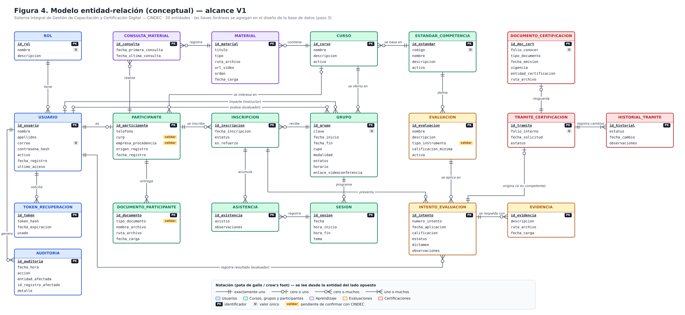

# 02 — Modelo entidad-relación (conceptual)

> Fase: **Diseño del Sistema** · Actividad del cronograma: *Elaboración del modelo entidad-relación*.
> Base: ERS v1.1 (`docs/01-requerimientos/ERS-CINDEC.docx`) y arquitectura aprobada (`01-arquitectura.md`).
> Estado: **borrador para revisión del residente** (2026-10-01).

## 1. Propósito y alcance

Este modelo identifica **qué información guarda el sistema** (entidades), **qué datos tiene cada una** (atributos) y **cómo se relacionan** (relaciones con su cardinalidad). Es un modelo **conceptual**: no incluye tipos de dato, llaves foráneas ni índices. Eso se define en el paso 3 (*Diseño de la base de datos*), que traduce este modelo a tablas MySQL con su diccionario de datos.

Notación: **pata de gallo (crow's foot)**. Cada relación se lee desde la entidad del lado opuesto; por ejemplo, "un CURSO *se oferta en* cero o muchos GRUPOS; cada GRUPO pertenece a exactamente un CURSO".

## 2. Diagrama

## 3. Entidades

20 entidades, agrupadas por el módulo del ERS al que pertenecen. **PK** = identificador; **U** = valor único; **[VALIDAR]** = atributo que se confirma con CINDEC.

### 3.1 Usuarios

| Entidad | Qué representa | Atributos | RF |
|---|---|---|---|
| **ROL** | Catálogo de los 5 roles de V1 (Administrador general, Coordinador, Instructor, Evaluador, Participante). | id_rol (PK), nombre (U), descripcion | RF-USR-02 |
| **USUARIO** | Toda persona que entra al sistema, sin importar su rol. | id_usuario (PK), nombre, apellidos, correo (U), contrasena_hash, activo, fecha_registro, ultimo_acceso | RF-USR-01, 04, 05 |
| **TOKEN_RECUPERACION** | Enlace de un solo uso para restablecer la contraseña. | id_token (PK), token_hash, fecha_expiracion, usado | RF-USR-06 |
| **AUDITORIA** | Bitácora de operaciones sensibles: quién, cuándo, qué y sobre qué registro. | id_auditoria (PK), fecha_hora, accion, entidad_afectada, id_registro_afectado, detalle | RF-USR-04, RNF-07 |

### 3.2 Cursos, grupos y participantes

| Entidad | Qué representa | Atributos | RF |
|---|---|---|---|
| **ESTANDAR_COMPETENCIA** | Estándar CONOCER que CINDEC evalúa (p. ej. EC0110.02). | id_estandar (PK), codigo (U), nombre, descripcion, activo | RF-CUR-01, RF-EVA-01 |
| **CURSO** | Plantilla o catálogo: *qué* se enseña. No tiene fechas ni cupo. | id_curso (PK), nombre, descripcion, activo | RF-CUR-01 |
| **GRUPO** | Oferta concreta de un curso: *cuándo*, *con quién* y *con qué cupo*. | id_grupo (PK), clave (U), fecha_inicio, fecha_fin, cupo, modalidad (presencial / en línea / mixta), estatus (planeado / en curso / concluido / cancelado), horario, enlace_videoconferencia | RF-CUR-02, 08, 09 |
| **SESION** | Cada clase programada de un grupo; es la base de la asistencia y de los recordatorios de "próxima sesión". | id_sesion (PK), fecha, hora_inicio, hora_fin, tema | RF-CUR-09, 10, RF-NOT-01 |
| **PARTICIPANTE** | Datos adicionales de un usuario con rol Participante. | id_participante (PK), telefono, curp [VALIDAR], empresa_procedencia [VALIDAR], origen_registro (autorregistro / alta por coordinador), fecha_registro | RF-CUR-03 |
| **DOCUMENTO_PARTICIPANTE** | Documentación que el participante entrega al registrarse. | id_documento (PK), tipo_documento [VALIDAR], nombre_archivo, ruta_archivo, fecha_carga | RF-CUR-03 |
| **INSCRIPCION** | Un participante dentro de un grupo. Resuelve la relación muchos-a-muchos participante ↔ grupo. | id_inscripcion (PK), fecha_inscripcion, estatus (inscrito / capacitación concluida / baja), es_refuerzo | RF-CUR-04, 06, RF-EVA-03, 04 |
| **ASISTENCIA** | Si un inscrito asistió o no a una sesión. | id_asistencia (PK), asistio, observaciones | RF-CUR-10 |

### 3.3 Aprendizaje

| Entidad | Qué representa | Atributos | RF |
|---|---|---|---|
| **MATERIAL** | Manual, presentación, PDF, ejercicio o video de un curso. Se guarda un archivo o un enlace a video. | id_material (PK), titulo, tipo, ruta_archivo, url_video, orden, fecha_carga | RF-APR-01, 02 |
| **CONSULTA_MATERIAL** | Registro de que un participante abrió o descargó un material. | id_consulta (PK), fecha_primera_consulta, fecha_ultima_consulta | RF-APR-03 |

### 3.4 Evaluaciones

| Entidad | Qué representa | Atributos | RF |
|---|---|---|---|
| **EVALUACION** | Instrumento de evaluación de un estándar, con su calificación mínima aprobatoria. | id_evaluacion (PK), nombre, descripcion, tipo_instrumento [VALIDAR], calificacion_minima (0-100), activa | RF-EVA-01, 04 |
| **INTENTO_EVALUACION** | Cada vez que un participante presenta una evaluación. Los reintentos son registros nuevos; nunca se sobrescribe un intento anterior. | id_intento (PK), numero_intento, fecha_aplicacion, calificacion (0-100), estatus (pendiente / aprobada / no aprobada), dictamen (competente / todavía en proceso), observaciones | RF-EVA-02, 03, 04, 05, RF-CERT-01 |
| **EVIDENCIA** | Archivo o descripción que respalda un intento. | id_evidencia (PK), descripcion, ruta_archivo, fecha_carga | RF-EVA-02 |

### 3.5 Certificaciones

| Entidad | Qué representa | Atributos | RF |
|---|---|---|---|
| **TRAMITE_CERTIFICACION** | Solicitud ante CONOCER para un participante competente. | id_tramite (PK), folio_interno (U), fecha_solicitud, estatus (solicitado / pagado / en trámite / emitido) | RF-CERT-02, 05, 07 |
| **HISTORIAL_TRAMITE** | Cada cambio de estatus del trámite, con su fecha. Permite saber *cuándo* se pagó, se emitió, etc. | id_historial (PK), estatus, fecha_cambio, observaciones | RF-CERT-02, 05 |
| **DOCUMENTO_CERTIFICACION** | El documento oficial que emite CONOCER, resguardado en el sistema. | id_doc_cert (PK), folio_conocer (U), tipo_documento, fecha_emision, vigencia, entidad_certificacion, ruta_archivo | RF-CERT-03, 04, 06 |

## 4. Relaciones

| # | Relación | Cardinalidad | Lectura |
|---|---|---|---|
| 1 | ROL — *tiene* — USUARIO | 1 : 0..N | Cada usuario tiene exactamente un rol (ERS: "uno de los cinco roles"). |
| 2 | USUARIO — *es* — PARTICIPANTE | 1 : 0..1 | Solo los usuarios con rol Participante tienen ficha de participante. |
| 3 | USUARIO — *solicita* — TOKEN_RECUPERACION | 1 : 0..N | |
| 4 | USUARIO — *genera* — AUDITORIA | 1 : 0..N | |
| 5 | USUARIO (instructor) — *imparte* — GRUPO | 0..1 : 0..N | Un grupo "planeado" puede no tener instructor asignado todavía. |
| 6 | USUARIO (evaluador) — *evalúa* — GRUPO | 0..1 : 0..N | Igual que el anterior. |
| 7 | ESTANDAR_COMPETENCIA — *se basa en* — CURSO | 1 : 0..N | Cada curso se basa en un estándar. |
| 8 | ESTANDAR_COMPETENCIA — *define* — EVALUACION | 1 : 0..N | El instrumento pertenece al estándar (ver decisión 5.3). |
| 9 | CURSO — *se oferta en* — GRUPO | 1 : 0..N | |
| 10 | CURSO — *contiene* — MATERIAL | 1 : 0..N | Los materiales son del curso y los ven todos sus grupos. |
| 11 | PARTICIPANTE — *se interesa en* — CURSO | 0..N : 0..1 | Curso de interés capturado en el autorregistro, mientras espera grupo. |
| 12 | PARTICIPANTE — *entrega* — DOCUMENTO_PARTICIPANTE | 1 : 0..N | |
| 13 | PARTICIPANTE — *se inscribe* — INSCRIPCION — *recibe* — GRUPO | 1 : 0..N : 1 | Muchos-a-muchos participante ↔ grupo, resuelta con INSCRIPCION. |
| 14 | GRUPO — *programa* — SESION | 1 : 0..N | |
| 15 | INSCRIPCION — *acumula* — ASISTENCIA — *registra* — SESION | 1 : 0..N : 1 | Muchos-a-muchos inscripción ↔ sesión. |
| 16 | PARTICIPANTE — *realiza* — CONSULTA_MATERIAL — *registra* — MATERIAL | 1 : 0..N : 1 | Muchos-a-muchos participante ↔ material. |
| 17 | INSCRIPCION — *presenta* — INTENTO_EVALUACION | 1 : 0..N | Los intentos se ligan a la inscripción porque ahí hay grupo, fecha y evaluador concretos. |
| 18 | EVALUACION — *se aplica en* — INTENTO_EVALUACION | 1 : 0..N | |
| 19 | USUARIO (evaluador) — *registra resultado* — INTENTO_EVALUACION | 1 : 0..N | Guarda quién capturó el resultado (RNF-06) y alimenta RF-CUR-07. |
| 20 | INTENTO_EVALUACION — *se respalda con* — EVIDENCIA | 1 : 0..N | |
| 21 | INTENTO_EVALUACION — *origina* — TRAMITE_CERTIFICACION | 1 : 0..1 | Solo un intento con dictamen "competente" puede originar un trámite. |
| 22 | TRAMITE_CERTIFICACION — *registra cambios* — HISTORIAL_TRAMITE | 1 : 1..N | Al crear el trámite se registra su primer estatus, "solicitado". |
| 23 | TRAMITE_CERTIFICACION — *resguarda* — DOCUMENTO_CERTIFICACION | 1 : 0..1 | Existe solo cuando CONOCER ya emitió el documento. |

## 5. Decisiones de modelado

1. **Curso ≠ Grupo** (corrección del 17-sep). El curso es la plantilla; las fechas, el cupo, la modalidad, el instructor y el evaluador van en el grupo. El cupo disponible (RF-CUR-04) **no se guarda**: se calcula como `cupo − inscripciones activas`. Así nunca queda desincronizado.
2. **Los 4 estados de RF-EVA-03 viven en lugares distintos**, para que no se confundan:
   - *Capacitación concluida* → `INSCRIPCION.estatus`
   - *Evaluación aprobada / no aprobada* → `INTENTO_EVALUACION.estatus` (calificación comparada contra `calificacion_minima`)
   - *Competente / todavía en proceso* → `INTENTO_EVALUACION.dictamen` (juicio del evaluador, distinto de la calificación)
   - *Certificación emitida* → `TRAMITE_CERTIFICACION.estatus`
3. **El instrumento de evaluación pertenece al estándar**, no al curso. CONOCER evalúa por estándar, y la calificación mínima "depende de cada estándar" (dato de Juan Alexis). Como cada curso apunta a un estándar, desde un grupo se llega al instrumento que le corresponde.
4. **Reintentos y refuerzo** (RF-EVA-04). Cada intento es un registro nuevo con `numero_intento`, así que el historial completo se conserva. Si el participante recursa como refuerzo, se crea una **nueva INSCRIPCION** en otro grupo con `es_refuerzo = sí`.
5. **Instructor y evaluador son usuarios con ese rol**, no entidades aparte: sus datos ya están en USUARIO, y un participante solo necesita ficha extra porque tiene datos propios (teléfono, documentos).
6. **Archivos fuera de la BD**. Materiales, evidencias, documentos del participante y PDF de CONOCER se guardan en la carpeta `uploads/`; la entidad solo guarda la ruta y sus datos (decisión de arquitectura, sección 3.3).
7. **Datos del certificado sin duplicar** (RF-CERT-04). El nombre del participante y el estándar del documento se obtienen por las relaciones (documento → trámite → intento → inscripción → participante / grupo → curso → estándar). Solo se guardan los datos propios del documento (folio CONOCER, tipo, emisión, vigencia, entidad).
8. **Sin multiempresa en V1** (RNF-21). No hay entidad EMPRESA. `empresa_procedencia` es solo un dato informativo del participante [VALIDAR]. Si en el futuro se convierte en una entidad, el resto del modelo no cambia.
9. **Reportes** (RF-REP) y **notificaciones** (RF-NOT-01) no necesitan entidades propias: los reportes son consultas sobre estas tablas, y los correos se generan a partir de SESION, INTENTO y TRAMITE.

## 6. Cobertura de requerimientos

| Módulo | RF cubiertos por el modelo |
|---|---|
| Usuarios | RF-USR-01 a 06 |
| Cursos, grupos y participantes | RF-CUR-01 a 10 |
| Aprendizaje | RF-APR-01 a 03 |
| Evaluaciones | RF-EVA-01 a 05 |
| Certificaciones | RF-CERT-01 a 07 |
| Reportes / Notificaciones | Consultas y procesos sobre las entidades anteriores (decisión 9) |

## 7. Puntos a validar con CINDEC (Juan Alexis)

- [ ] **CURP del participante:** ¿se captura en el registro? Normalmente CONOCER la pide para el trámite de certificación.
- [ ] **Empresa de procedencia:** ¿sirve guardarla como dato informativo (texto libre)?
- [ ] **Documentación del participante:** ¿qué documentos se piden exactamente (p. ej. identificación, comprobante)? Así se arma el catálogo de `tipo_documento`.
- [ ] **Tipo de instrumento de evaluación:** ¿qué tipos maneja CINDEC (cuestionario, guía de observación, lista de cotejo…)?
- [ ] **Un rol por usuario:** ¿una misma persona puede ser instructor y evaluador al mismo tiempo? Si sí, ROL–USUARIO pasaría a ser muchos-a-muchos.
- [ ] Revisión de este borrador por el residente.
