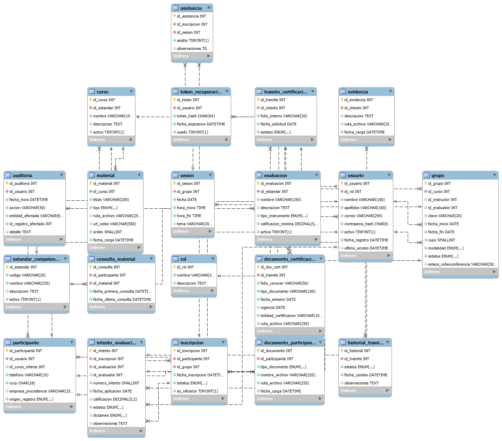

# 03 — Diseño de la base de datos · Parte 3: diseño físico y diccionario de datos

> Fase: **Diseño del Sistema** · Actividad del cronograma: *Diseño de la base de datos*.
> Base: diseño lógico (`03-diseno-logico.md`) y normalización (`03-2-normalizacion.md`), ambos aprobados.
> Estado: **borrador para revisión del residente** (2026-10-21). Generado a partir de los scripts de `sql/` ejecutados y probados en MySQL 8.0.42.

## 1. Resumen

Base de datos `cindec_db` en **MySQL 8.0** (motor InnoDB, juego de caracteres `utf8mb4`, cotejamiento `utf8mb4_0900_ai_ci`): **20 tablas, 128 columnas, 26 llaves foráneas** y 5 índices adicionales. La estructura se creó y se probó con los scripts de la carpeta `sql/`:

| Script | Contenido |
|---|---|
| `01-crear-base-de-datos.sql` | Crea `cindec_db` (utf8mb4). |
| `02-modulo-usuarios.sql` | rol, usuario, token_recuperacion, auditoria |
| `03-modulo-cursos-participantes.sql` | estandar_competencia, curso, grupo, sesion, participante, documento_participante, inscripcion, asistencia |
| `04-modulo-aprendizaje.sql` | material, consulta_material |
| `05-modulo-evaluaciones.sql` | evaluacion, intento_evaluacion, evidencia |
| `06-modulo-certificaciones.sql` | tramite_certificacion, historial_tramite, documento_certificacion |
| `07-indices.sql` | 5 índices para búsquedas y reportes |
| `08-datos-prueba.sql` | Datos ficticios para probar la estructura |
| `09-pruebas-reglas.sql` | 8 pruebas que deben fallar + 1 de ON DELETE CASCADE |

Los scripts se ejecutan en ese orden. En la fase de Desarrollo esta misma estructura se recrea con migraciones de Sequelize (arquitectura, sección 3.3).

## 2. Convenciones

| Elemento | Convención |
|---|---|
| Tablas y columnas | Minúsculas, singular, con guion bajo (`intento_evaluacion`). |
| Llaves primarias | `id_<tabla>`, `INT UNSIGNED AUTO_INCREMENT`. |
| Llaves foráneas | Mismo tipo que la PK a la que apuntan (`INT UNSIGNED`). Por defecto `ON DELETE RESTRICT ON UPDATE CASCADE`; excepciones: `token_recuperacion` (CASCADE) y `participante.id_curso_interes` (SET NULL). |
| Nombres de restricciones | `pk_` llave primaria · `uq_` único · `fk_` llave foránea · `ck_` CHECK · `idx_` índice. |
| Tipos | Texto corto `VARCHAR(n)`, largo fijo `CHAR(n)`, texto largo `TEXT`, fechas `DATE`/`DATETIME`/`TIME`, sí/no `BOOLEAN` (TINYINT(1)), calificaciones `DECIMAL(5,2)`, listas cerradas `ENUM`. |
| Nulos | `NOT NULL` salvo los campos opcionales del diseño. |
| Borrado | Usuarios, cursos, estándares y evaluaciones se desactivan (`activo = 0`); no se borran. |

**Columnas de la tabla de cada entidad:** Llave = PK (primaria), FK (foránea), U (única), U(a, b) (única en combinación). Default = valor que MySQL pone si no se indica.

## 3. Tablas

| # | Tabla | Módulo | Columnas | FK | Descripción |
|---|---|---|---|---|---|
| 1 | `rol` | Usuarios | 3 | 0 | Catálogo de los 5 roles de V1 (RF-USR-02). |
| 2 | `usuario` | Usuarios | 9 | 1 | Toda persona que entra al sistema (RF-USR-01, 04, 05). |
| 3 | `token_recuperacion` | Usuarios | 5 | 1 | Enlace de un solo uso para restablecer la contraseña (RF-USR-06). |
| 4 | `auditoria` | Usuarios | 7 | 1 | Bitácora de operaciones sensibles: quién, cuándo, qué y sobre qué registro (RNF-07). |
| 5 | `estandar_competencia` | Cursos, grupos y participantes | 5 | 0 | Estándares de CONOCER que CINDEC evalúa (p. |
| 6 | `curso` | Cursos, grupos y participantes | 5 | 1 | Plantilla: QUÉ se enseña. |
| 7 | `grupo` | Cursos, grupos y participantes | 11 | 3 | Oferta concreta de un curso: CUÁNDO, CON QUIÉN y con qué CUPO (RF-CUR-02, 05, 08, 09). |
| 8 | `sesion` | Cursos, grupos y participantes | 6 | 1 | Cada clase programada de un grupo: base de la asistencia y del horario (RF-CUR-09, 10). |
| 9 | `participante` | Cursos, grupos y participantes | 7 | 2 | Ficha del alumno: datos que solo tiene un usuario con rol Participante (RF-CUR-03). |
| 10 | `documento_participante` | Cursos, grupos y participantes | 6 | 1 | Documentos que entrega el participante (Manual del participante CONOCER, pp. |
| 11 | `inscripcion` | Cursos, grupos y participantes | 6 | 2 | Un participante dentro de un grupo: resuelve la relación muchos-a-muchos (RF-CUR-04, 06). |
| 12 | `asistencia` | Cursos, grupos y participantes | 5 | 2 | Si un inscrito asistió o no a una sesión (RF-CUR-10). |
| 13 | `material` | Aprendizaje | 8 | 1 | Manual, presentación, PDF, ejercicio o video de un curso (RF-APR-01, 02). |
| 14 | `consulta_material` | Aprendizaje | 5 | 2 | Registro de que un participante abrió o descargó un material (RF-APR-03). |
| 15 | `evaluacion` | Evaluaciones | 7 | 1 | Instrumento de evaluación de un estándar, con su calificación mínima (RF-EVA-01, 04). |
| 16 | `intento_evaluacion` | Evaluaciones | 10 | 3 | Cada vez que un participante presenta una evaluación (RF-EVA-02 a 05, RF-CERT-01). |
| 17 | `evidencia` | Evaluaciones | 5 | 1 | Archivo o descripción que respalda un intento (RF-EVA-02). |
| 18 | `tramite_certificacion` | Certificaciones | 5 | 1 | Solicitud ante CONOCER para un participante competente (RF-CERT-02, 05, 07). |
| 19 | `historial_tramite` | Certificaciones | 5 | 1 | Cada cambio de estatus del trámite, con su fecha (RF-CERT-02, 05). |
| 20 | `documento_certificacion` | Certificaciones | 8 | 1 | Documento oficial emitido por CONOCER, resguardado en el sistema (RF-CERT-03, 04, 06). |

## Módulo Usuarios

### 3.1 `rol`

Catálogo de los 5 roles de V1 (RF-USR-02).

| Columna | Tipo | Nulo | Llave | Default | Restricciones | Descripción |
|---|---|---|---|---|---|---|
| `id_rol` | `INT UNSIGNED` | No | PK | AUTO_INCREMENT |  | Identificador del rol. |
| `nombre` | `VARCHAR(50)` | No | U |  |  | Nombre del rol: Administrador general, Coordinador de capacitación, Instructor, Evaluador o Participante. |
| `descripcion` | `TEXT` | Sí |  |  |  | Explicación breve de lo que puede hacer el rol. |

### 3.2 `usuario`

Toda persona que entra al sistema (RF-USR-01, 04, 05). Un rol por usuario.

| Columna | Tipo | Nulo | Llave | Default | Restricciones | Descripción |
|---|---|---|---|---|---|---|
| `id_usuario` | `INT UNSIGNED` | No | PK | AUTO_INCREMENT |  | Identificador del usuario. |
| `id_rol` | `INT UNSIGNED` | No | FK |  | FK → rol.id_rol (ON DELETE RESTRICT) | Rol del usuario (uno por usuario, RF-USR-02). |
| `nombre` | `VARCHAR(100)` | No |  |  |  | Nombre(s) de la persona. |
| `apellidos` | `VARCHAR(100)` | No |  |  |  | Apellidos de la persona. |
| `correo` | `VARCHAR(254)` | No | U |  |  | Correo electrónico; con él se inicia sesión. No se repite. |
| `contrasena_hash` | `CHAR(60)` | No |  |  |  | Hash bcrypt de la contraseña; nunca se guarda la contraseña real (RNF-05). |
| `activo` | `BOOLEAN` | No |  | TRUE (1) |  | 1 = cuenta activa, 0 = desactivada. Se desactiva en lugar de borrar. |
| `fecha_registro` | `DATETIME` | No |  | CURRENT_TIMESTAMP |  | Fecha y hora de alta de la cuenta. |
| `ultimo_acceso` | `DATETIME` | Sí |  |  |  | Fecha y hora del último inicio de sesión; vacío si nunca ha entrado. |

### 3.3 `token_recuperacion`

Enlace de un solo uso para restablecer la contraseña (RF-USR-06). Es un dato temporal: si se borra el usuario, sus tokens se borran con él (CASCADE).

| Columna | Tipo | Nulo | Llave | Default | Restricciones | Descripción |
|---|---|---|---|---|---|---|
| `id_token` | `INT UNSIGNED` | No | PK | AUTO_INCREMENT |  | Identificador del token. |
| `id_usuario` | `INT UNSIGNED` | No | FK |  | FK → usuario.id_usuario (ON DELETE CASCADE) | Usuario que pidió recuperar su contraseña. |
| `token_hash` | `CHAR(64)` | No | U |  |  | Hash SHA-256 del enlace enviado por correo. |
| `fecha_expiracion` | `DATETIME` | No |  |  |  | Momento en que el enlace deja de servir. |
| `usado` | `BOOLEAN` | No |  | FALSE (0) |  | 1 = ya se usó (un solo uso), 0 = disponible. |

### 3.4 `auditoria`

Bitácora de operaciones sensibles: quién, cuándo, qué y sobre qué registro (RNF-07). entidad_afectada + id_registro_afectado NO llevan FK a propósito: pueden apuntar a cualquier tabla.

| Columna | Tipo | Nulo | Llave | Default | Restricciones | Descripción |
|---|---|---|---|---|---|---|
| `id_auditoria` | `INT UNSIGNED` | No | PK | AUTO_INCREMENT |  | Identificador del registro de bitácora. |
| `id_usuario` | `INT UNSIGNED` | No | FK |  | FK → usuario.id_usuario (ON DELETE RESTRICT) | Usuario que hizo la operación. |
| `fecha_hora` | `DATETIME` | No |  | CURRENT_TIMESTAMP |  | Momento de la operación. |
| `accion` | `VARCHAR(50)` | No |  |  |  | Qué se hizo: crear, modificar, desactivar, etc. |
| `entidad_afectada` | `VARCHAR(64)` | No |  |  |  | Nombre de la tabla afectada. |
| `id_registro_afectado` | `INT UNSIGNED` | No |  |  |  | Identificador del registro afectado en esa tabla. |
| `detalle` | `TEXT` | Sí |  |  |  | Descripción libre del cambio. |

## Módulo Cursos, grupos y participantes

### 3.5 `estandar_competencia`

Estándares de CONOCER que CINDEC evalúa (p. ej. EC0110.02).

| Columna | Tipo | Nulo | Llave | Default | Restricciones | Descripción |
|---|---|---|---|---|---|---|
| `id_estandar` | `INT UNSIGNED` | No | PK | AUTO_INCREMENT |  | Identificador del estándar. |
| `codigo` | `VARCHAR(20)` | No | U |  |  | Código CONOCER del estándar, p. ej. EC0110.02. No se repite. |
| `nombre` | `VARCHAR(255)` | No |  |  |  | Nombre oficial del estándar. |
| `descripcion` | `TEXT` | Sí |  |  |  | Descripción del estándar. |
| `activo` | `BOOLEAN` | No |  | TRUE (1) |  | 1 = vigente en CINDEC, 0 = ya no se ofrece. |

### 3.6 `curso`

Plantilla: QUÉ se enseña. Sin fechas ni cupo (eso es del grupo). RF-CUR-01.

| Columna | Tipo | Nulo | Llave | Default | Restricciones | Descripción |
|---|---|---|---|---|---|---|
| `id_curso` | `INT UNSIGNED` | No | PK | AUTO_INCREMENT |  | Identificador del curso. |
| `id_estandar` | `INT UNSIGNED` | No | FK |  | FK → estandar_competencia.id_estandar (ON DELETE RESTRICT) | Estándar en el que se basa el curso. |
| `nombre` | `VARCHAR(150)` | No |  |  |  | Nombre del curso. |
| `descripcion` | `TEXT` | Sí |  |  |  | Descripción del curso. |
| `activo` | `BOOLEAN` | No |  | TRUE (1) |  | 1 = se ofrece, 0 = desactivado. |

### 3.7 `grupo`

Oferta concreta de un curso: CUÁNDO, CON QUIÉN y con qué CUPO (RF-CUR-02, 05, 08, 09). El cupo disponible NO se guarda: se calcula (cupo - inscripciones activas). El horario NO se guarda: se obtiene de las sesiones (normalización).

| Columna | Tipo | Nulo | Llave | Default | Restricciones | Descripción |
|---|---|---|---|---|---|---|
| `id_grupo` | `INT UNSIGNED` | No | PK | AUTO_INCREMENT |  | Identificador del grupo. |
| `id_curso` | `INT UNSIGNED` | No | FK |  | FK → curso.id_curso (ON DELETE RESTRICT) | Curso que se imparte en este grupo. |
| `id_instructor` | `INT UNSIGNED` | Sí | FK |  | FK → usuario.id_usuario (ON DELETE RESTRICT) | Usuario instructor asignado; vacío mientras el grupo está planeado. |
| `id_evaluador` | `INT UNSIGNED` | Sí | FK |  | FK → usuario.id_usuario (ON DELETE RESTRICT) | Usuario evaluador asignado; vacío mientras el grupo está planeado. |
| `clave` | `VARCHAR(20)` | No | U |  |  | Clave del grupo, p. ej. G-2026-01. No se repite. |
| `fecha_inicio` | `DATE` | No |  |  | CHECK (fecha_fin >= fecha_inicio) (ck_grupo_fechas) | Fecha de inicio del grupo. |
| `fecha_fin` | `DATE` | No |  |  |  | Fecha de término; no puede ser anterior al inicio. |
| `cupo` | `SMALLINT UNSIGNED` | No |  |  | CHECK (cupo > 0) (ck_grupo_cupo) | Número máximo de participantes; mayor que 0. El cupo disponible se calcula. |
| `modalidad` | `ENUM('presencial','en_linea','mixta')` | No |  |  |  | presencial, en_linea o mixta. |
| `estatus` | `ENUM('planeado','en_curso','concluido','cancelado')` | No |  | 'planeado' |  | planeado, en_curso, concluido o cancelado (RF-CUR-08). |
| `enlace_videoconferencia` | `VARCHAR(500)` | Sí |  |  |  | Enlace de la sesión en línea; solo para modalidad en línea o mixta. |

### 3.8 `sesion`

Cada clase programada de un grupo: base de la asistencia y del horario (RF-CUR-09, 10).

| Columna | Tipo | Nulo | Llave | Default | Restricciones | Descripción |
|---|---|---|---|---|---|---|
| `id_sesion` | `INT UNSIGNED` | No | PK | AUTO_INCREMENT |  | Identificador de la sesión. |
| `id_grupo` | `INT UNSIGNED` | No | FK |  | FK → grupo.id_grupo (ON DELETE RESTRICT) | Grupo al que pertenece la sesión. |
| `fecha` | `DATE` | No |  |  |  | Día de la sesión. |
| `hora_inicio` | `TIME` | No |  |  | CHECK (hora_fin > hora_inicio) (ck_sesion_horas) | Hora de inicio. |
| `hora_fin` | `TIME` | No |  |  |  | Hora de término; posterior al inicio. |
| `tema` | `VARCHAR(200)` | Sí |  |  |  | Tema de la sesión. |

### 3.9 `participante`

Ficha del alumno: datos que solo tiene un usuario con rol Participante (RF-CUR-03). id_usuario es UNIQUE: una cuenta tiene como máximo una ficha (relación 1 : 0..1).

| Columna | Tipo | Nulo | Llave | Default | Restricciones | Descripción |
|---|---|---|---|---|---|---|
| `id_participante` | `INT UNSIGNED` | No | PK | AUTO_INCREMENT |  | Identificador de la ficha del participante. |
| `id_usuario` | `INT UNSIGNED` | No | U, FK |  | FK → usuario.id_usuario (ON DELETE RESTRICT) | Cuenta de usuario del participante; una ficha por cuenta. |
| `id_curso_interes` | `INT UNSIGNED` | Sí | FK |  | FK → curso.id_curso (ON DELETE SET NULL) | Curso elegido en el autorregistro; se vacía si el curso se elimina. |
| `telefono` | `VARCHAR(15)` | No |  |  |  | Teléfono de contacto. |
| `curp` | `CHAR(18)` | No | U |  | CHECK (CHAR_LENGTH(curp) = 18) (ck_participante_curp) | CURP del participante; exactamente 18 caracteres y no se repite. |
| `empresa_procedencia` | `VARCHAR(150)` | Sí |  |  |  | Empresa donde trabaja (información laboral de la ficha CONOCER); opcional. |
| `origen_registro` | `ENUM('autorregistro','alta_coordinador')` | No |  |  |  | autorregistro o alta_coordinador. |

### 3.10 `documento_participante`

Documentos que entrega el participante (Manual del participante CONOCER, pp. 35-36). El archivo vive en la carpeta uploads/; aquí solo se guarda su ruta.

| Columna | Tipo | Nulo | Llave | Default | Restricciones | Descripción |
|---|---|---|---|---|---|---|
| `id_documento` | `INT UNSIGNED` | No | PK | AUTO_INCREMENT |  | Identificador del documento. |
| `id_participante` | `INT UNSIGNED` | No | FK |  | FK → participante.id_participante (ON DELETE RESTRICT) | Participante que entregó el documento. |
| `tipo_documento` | `ENUM('ine','cartilla_militar','cedula_profesional','pasaporte', 'fotografia','ficha_registro','identificacion_tutor')` | No |  |  |  | ine, cartilla_militar, cedula_profesional, pasaporte, fotografia, ficha_registro o identificacion_tutor. |
| `nombre_archivo` | `VARCHAR(255)` | No |  |  |  | Nombre original del archivo subido. |
| `ruta_archivo` | `VARCHAR(255)` | No |  |  |  | Ruta del archivo en la carpeta uploads/ del servidor. |
| `fecha_carga` | `DATETIME` | No |  | CURRENT_TIMESTAMP |  | Momento en que se subió. |

### 3.11 `inscripcion`

Un participante dentro de un grupo: resuelve la relación muchos-a-muchos (RF-CUR-04, 06). UNIQUE (id_participante, id_grupo): nadie se inscribe dos veces al mismo grupo. El control de CUPO lo hace el backend (una FK o un CHECK no pueden contar filas).

| Columna | Tipo | Nulo | Llave | Default | Restricciones | Descripción |
|---|---|---|---|---|---|---|
| `id_inscripcion` | `INT UNSIGNED` | No | PK | AUTO_INCREMENT |  | Identificador de la inscripción. |
| `id_participante` | `INT UNSIGNED` | No | U(id_participante, id_grupo), FK |  | FK → participante.id_participante (ON DELETE RESTRICT) | Participante inscrito. |
| `id_grupo` | `INT UNSIGNED` | No | U(id_participante, id_grupo), FK |  | FK → grupo.id_grupo (ON DELETE RESTRICT) | Grupo al que se inscribió. |
| `fecha_inscripcion` | `DATETIME` | No |  | CURRENT_TIMESTAMP |  | Momento de la inscripción. |
| `estatus` | `ENUM('inscrito','capacitacion_concluida','baja')` | No |  | 'inscrito' |  | inscrito, capacitacion_concluida o baja. |
| `es_refuerzo` | `BOOLEAN` | No |  | FALSE (0) |  | 1 = recursa el curso como refuerzo antes de reevaluarse (RF-EVA-04). |

### 3.12 `asistencia`

Si un inscrito asistió o no a una sesión (RF-CUR-10). UNIQUE (id_inscripcion, id_sesion): una sola marca de asistencia por persona y sesión. Que la sesión sea del mismo grupo de la inscripción lo valida el backend.

| Columna | Tipo | Nulo | Llave | Default | Restricciones | Descripción |
|---|---|---|---|---|---|---|
| `id_asistencia` | `INT UNSIGNED` | No | PK | AUTO_INCREMENT |  | Identificador del registro de asistencia. |
| `id_inscripcion` | `INT UNSIGNED` | No | U(id_inscripcion, id_sesion), FK |  | FK → inscripcion.id_inscripcion (ON DELETE RESTRICT) | Inscripción (participante en el grupo). |
| `id_sesion` | `INT UNSIGNED` | No | U(id_inscripcion, id_sesion), FK |  | FK → sesion.id_sesion (ON DELETE RESTRICT) | Sesión en la que se pasó lista. |
| `asistio` | `BOOLEAN` | No |  |  |  | 1 = asistió, 0 = faltó. Sin valor por defecto: se marca siempre. |
| `observaciones` | `TEXT` | Sí |  |  |  | Notas, p. ej. llegó tarde. |

## Módulo Aprendizaje

### 3.13 `material`

Manual, presentación, PDF, ejercicio o video de un curso (RF-APR-01, 02). Lleva un archivo (ruta_archivo) o un enlace a video (url_video): al menos uno de los dos.

| Columna | Tipo | Nulo | Llave | Default | Restricciones | Descripción |
|---|---|---|---|---|---|---|
| `id_material` | `INT UNSIGNED` | No | PK | AUTO_INCREMENT |  | Identificador del material. |
| `id_curso` | `INT UNSIGNED` | No | FK |  | FK → curso.id_curso (ON DELETE RESTRICT) | Curso al que pertenece el material. |
| `titulo` | `VARCHAR(200)` | No |  |  |  | Título del material. |
| `tipo` | `ENUM('manual','presentacion','pdf','ejercicio','video')` | No |  |  |  | manual, presentacion, pdf, ejercicio o video. |
| `ruta_archivo` | `VARCHAR(255)` | Sí |  |  | CHECK (ruta_archivo IS NOT NULL OR url_video IS NOT NULL) (ck_material_contenido) | Ruta del archivo en uploads/; vacía si es un enlace. |
| `url_video` | `VARCHAR(500)` | Sí |  |  |  | Enlace al video; vacío si es un archivo. Debe existir archivo o enlace. |
| `orden` | `SMALLINT UNSIGNED` | No |  | 1 |  | Posición del material en la lista del curso. |
| `fecha_carga` | `DATETIME` | No |  | CURRENT_TIMESTAMP |  | Momento en que se subió. |

### 3.14 `consulta_material`

Registro de que un participante abrió o descargó un material (RF-APR-03). Una fila por participante y material; cada nueva consulta actualiza fecha_ultima_consulta.

| Columna | Tipo | Nulo | Llave | Default | Restricciones | Descripción |
|---|---|---|---|---|---|---|
| `id_consulta` | `INT UNSIGNED` | No | PK | AUTO_INCREMENT |  | Identificador de la consulta. |
| `id_participante` | `INT UNSIGNED` | No | U(id_participante, id_material), FK |  | FK → participante.id_participante (ON DELETE RESTRICT) | Participante que abrió el material. |
| `id_material` | `INT UNSIGNED` | No | U(id_participante, id_material), FK |  | FK → material.id_material (ON DELETE RESTRICT) | Material consultado. |
| `fecha_primera_consulta` | `DATETIME` | No |  | CURRENT_TIMESTAMP | CHECK (fecha_ultima_consulta >= fecha_primera_consulta) (ck_consulta_fechas) | Primera vez que lo abrió. |
| `fecha_ultima_consulta` | `DATETIME` | No |  | CURRENT_TIMESTAMP (se actualiza sola) |  | Última vez que lo abrió; MySQL la actualiza sola. |

## Módulo Evaluaciones

### 3.15 `evaluacion`

Instrumento de evaluación de un estándar, con su calificación mínima (RF-EVA-01, 04). Tipos de instrumento: Manual del participante CONOCER, pp. 53-54.

| Columna | Tipo | Nulo | Llave | Default | Restricciones | Descripción |
|---|---|---|---|---|---|---|
| `id_evaluacion` | `INT UNSIGNED` | No | PK | AUTO_INCREMENT |  | Identificador de la evaluación. |
| `id_estandar` | `INT UNSIGNED` | No | FK |  | FK → estandar_competencia.id_estandar (ON DELETE RESTRICT) | Estándar al que pertenece el instrumento. |
| `nombre` | `VARCHAR(150)` | No |  |  |  | Nombre de la evaluación. |
| `descripcion` | `TEXT` | Sí |  |  |  | Descripción del instrumento. |
| `tipo_instrumento` | `ENUM('guia_observacion','lista_cotejo','cuestionario')` | No |  |  |  | guia_observacion, lista_cotejo o cuestionario (manual CONOCER, pp. 53-54). |
| `calificacion_minima` | `DECIMAL(5,2)` | No |  |  | CHECK (calificacion_minima BETWEEN 0 AND 100) (ck_evaluacion_minima) | Calificación mínima aprobatoria, de 0 a 100; depende del estándar. |
| `activa` | `BOOLEAN` | No |  | TRUE (1) |  | 1 = en uso, 0 = desactivada. |

### 3.16 `intento_evaluacion`

Cada vez que un participante presenta una evaluación (RF-EVA-02 a 05, RF-CERT-01). Un reintento es una fila NUEVA: nunca se sobrescribe un intento anterior. estatus = excepción documentada en la normalización (se guarda el resultado del día).

| Columna | Tipo | Nulo | Llave | Default | Restricciones | Descripción |
|---|---|---|---|---|---|---|
| `id_intento` | `INT UNSIGNED` | No | PK | AUTO_INCREMENT |  | Identificador del intento. |
| `id_inscripcion` | `INT UNSIGNED` | No | U(id_inscripcion, id_evaluacion, numero_intento), FK |  | FK → inscripcion.id_inscripcion (ON DELETE RESTRICT) | Inscripción del participante evaluado. |
| `id_evaluacion` | `INT UNSIGNED` | No | U(id_inscripcion, id_evaluacion, numero_intento), FK |  | FK → evaluacion.id_evaluacion (ON DELETE RESTRICT) | Evaluación que presentó. |
| `id_evaluador` | `INT UNSIGNED` | Sí | FK |  | FK → usuario.id_usuario (ON DELETE RESTRICT) | Usuario que registró el resultado; vacío mientras está pendiente. |
| `numero_intento` | `SMALLINT UNSIGNED` | No | U(id_inscripcion, id_evaluacion, numero_intento) |  | CHECK (numero_intento >= 1) (ck_intento_numero) | Número de intento: 1, 2, 3…; mayor o igual a 1. |
| `fecha_aplicacion` | `DATE` | No |  |  |  | Fecha en que se aplica la evaluación. |
| `calificacion` | `DECIMAL(5,2)` | Sí |  |  | CHECK (calificacion BETWEEN 0 AND 100) (ck_intento_calificacion); CHECK ((estatus = 'pendiente' AND calificacion IS NULL) OR (estatus <> 'pendiente' AND calificacion IS NOT NULL)) (ck_intento_estatus) | Calificación de 0 a 100; vacía mientras está pendiente. |
| `estatus` | `ENUM('pendiente','aprobada','no_aprobada')` | No |  | 'pendiente' | CHECK (dictamen IS NULL OR estatus <> 'pendiente') (ck_intento_dictamen) | pendiente, aprobada o no_aprobada. Excepción documentada: se guarda el resultado del día. |
| `dictamen` | `ENUM('competente','todavia_no_competente')` | Sí |  |  |  | competente o todavia_no_competente; solo cuando ya se evaluó. |
| `observaciones` | `TEXT` | Sí |  |  |  | Comentarios del evaluador. |

### 3.17 `evidencia`

Archivo o descripción que respalda un intento (RF-EVA-02). Al menos uno de los dos.

| Columna | Tipo | Nulo | Llave | Default | Restricciones | Descripción |
|---|---|---|---|---|---|---|
| `id_evidencia` | `INT UNSIGNED` | No | PK | AUTO_INCREMENT |  | Identificador de la evidencia. |
| `id_intento` | `INT UNSIGNED` | No | FK |  | FK → intento_evaluacion.id_intento (ON DELETE RESTRICT) | Intento al que respalda. |
| `descripcion` | `TEXT` | Sí |  |  | CHECK (descripcion IS NOT NULL OR ruta_archivo IS NOT NULL) (ck_evidencia_contenido) | Descripción de la evidencia. |
| `ruta_archivo` | `VARCHAR(255)` | Sí |  |  |  | Archivo de la evidencia en uploads/. Debe haber descripción o archivo. |
| `fecha_carga` | `DATETIME` | No |  | CURRENT_TIMESTAMP |  | Momento en que se registró. |

## Módulo Certificaciones

### 3.18 `tramite_certificacion`

Solicitud ante CONOCER para un participante competente (RF-CERT-02, 05, 07). id_intento UNIQUE: un solo trámite por intento (relación 1 : 0..1). Que el intento sea "competente" lo valida el backend. estatus = excepción documentada en la normalización (se actualiza junto con el historial).

| Columna | Tipo | Nulo | Llave | Default | Restricciones | Descripción |
|---|---|---|---|---|---|---|
| `id_tramite` | `INT UNSIGNED` | No | PK | AUTO_INCREMENT |  | Identificador del trámite. |
| `id_intento` | `INT UNSIGNED` | No | U, FK |  | FK → intento_evaluacion.id_intento (ON DELETE RESTRICT) | Intento competente que origina el trámite; uno por intento. |
| `folio_interno` | `VARCHAR(30)` | No | U |  |  | Folio interno de CINDEC; no se repite. |
| `fecha_solicitud` | `DATE` | No |  |  |  | Fecha en que se solicitó a CONOCER. |
| `estatus` | `ENUM('solicitado','pagado','en_tramite','emitido')` | No |  | 'solicitado' |  | solicitado, pagado, en_tramite o emitido. Excepción documentada; se actualiza junto con el historial. |

### 3.19 `historial_tramite`

Cada cambio de estatus del trámite, con su fecha (RF-CERT-02, 05).

| Columna | Tipo | Nulo | Llave | Default | Restricciones | Descripción |
|---|---|---|---|---|---|---|
| `id_historial` | `INT UNSIGNED` | No | PK | AUTO_INCREMENT |  | Identificador del cambio. |
| `id_tramite` | `INT UNSIGNED` | No | FK |  | FK → tramite_certificacion.id_tramite (ON DELETE RESTRICT) | Trámite que cambió. |
| `estatus` | `ENUM('solicitado','pagado','en_tramite','emitido')` | No |  |  |  | Estatus al que cambió el trámite. |
| `fecha_cambio` | `DATETIME` | No |  | CURRENT_TIMESTAMP |  | Momento del cambio. |
| `observaciones` | `TEXT` | Sí |  |  |  | Notas del cambio. |

### 3.20 `documento_certificacion`

Documento oficial emitido por CONOCER, resguardado en el sistema (RF-CERT-03, 04, 06). id_tramite UNIQUE: un documento por trámite (relación 1 : 0..1). El nombre del participante y el estándar NO se guardan aquí: se obtienen por las relaciones.

| Columna | Tipo | Nulo | Llave | Default | Restricciones | Descripción |
|---|---|---|---|---|---|---|
| `id_doc_cert` | `INT UNSIGNED` | No | PK | AUTO_INCREMENT |  | Identificador del documento. |
| `id_tramite` | `INT UNSIGNED` | No | U, FK |  | FK → tramite_certificacion.id_tramite (ON DELETE RESTRICT) | Trámite al que corresponde; un documento por trámite. |
| `folio_conocer` | `VARCHAR(50)` | No | U |  |  | Folio asignado por CONOCER; no se repite. |
| `tipo_documento` | `VARCHAR(100)` | No |  |  |  | Tipo de documento, p. ej. Certificado de competencia laboral. |
| `fecha_emision` | `DATE` | No |  |  | CHECK (vigencia IS NULL OR vigencia >= fecha_emision) (ck_doc_cert_vigencia) | Fecha en que CONOCER lo emitió. |
| `vigencia` | `DATE` | Sí |  |  |  | Fecha de vencimiento, si aplica; no anterior a la emisión. |
| `entidad_certificacion` | `VARCHAR(150)` | No |  | 'CINDEC (ECE516-22)' |  | Entidad de certificación; por defecto CINDEC (ECE516-22). |
| `ruta_archivo` | `VARCHAR(255)` | No |  |  |  | PDF oficial en uploads/. |

## 4. Índices adicionales

Además de los índices que MySQL crea solo para cada PRIMARY KEY, UNIQUE y FOREIGN KEY:

| Índice | Tabla | Columnas | Para qué |
|---|---|---|---|
| `idx_usuario_apellidos_nombre` | `usuario` | apellidos, nombre | Buscar personas por nombre al inscribir (RF-CUR-04). |
| `idx_usuario_fecha_registro` | `usuario` | fecha_registro | Participantes registrados por periodo (RF-REP-01). |
| `idx_grupo_estatus_inicio` | `grupo` | estatus, fecha_inicio | Grupos por estatus y fechas (RF-CUR-08, RF-REP-01). |
| `idx_tramite_estatus_fecha` | `tramite_certificacion` | estatus, fecha_solicitud | Certificaciones por estatus y fechas (RF-CERT-05). |
| `idx_auditoria_entidad_registro` | `auditoria` | entidad_afectada, id_registro_afectado | Bitácora de un registro concreto (RNF-07). |

## 5. Pruebas realizadas (21-oct-2026)

Con los datos de `08-datos-prueba.sql`, la consulta que une 8 tablas devolvió el historial esperado (intentos, dictamen y trámite). Las pruebas de `09-pruebas-reglas.sql` dieron el resultado esperado:

| # | Intento | Resultado |
|---|---|---|
| 1 | Correo repetido | Rechazado — Error 1062 (`uq_usuario_correo`) |
| 2 | Usuario con rol inexistente | Rechazado — Error 1452 (`fk_usuario_rol`) |
| 3 | Borrar un rol con usuarios | Rechazado — Error 1451 (ON DELETE RESTRICT) |
| 4 | Grupo que termina antes de empezar | Rechazado — Error 3819 (`ck_grupo_fechas`) |
| 5 | Calificación de 150 | Rechazado — Error 3819 (`ck_intento_calificacion`) |
| 6 | "Aprobada" sin calificación | Rechazado — Error 3819 (`ck_intento_estatus`) |
| 7 | Inscribir dos veces al mismo grupo | Rechazado — Error 1062 (`uq_inscripcion_participante_grupo`) |
| 8 | Modalidad fuera de la lista | Rechazado — Error 1265 (ENUM) |
| 9 | Borrar un usuario con token | Aceptado — el token se borró solo (ON DELETE CASCADE) |

## 6. Reglas que valida el backend

Ver `03-diseno-logico.md`, sección 4: rol correcto del instructor/evaluador, control de cupo, evaluación del mismo estándar, trámite solo desde un intento competente, historial en la misma transacción, cálculo del estatus aprobada/no aprobada contra la calificación mínima.
