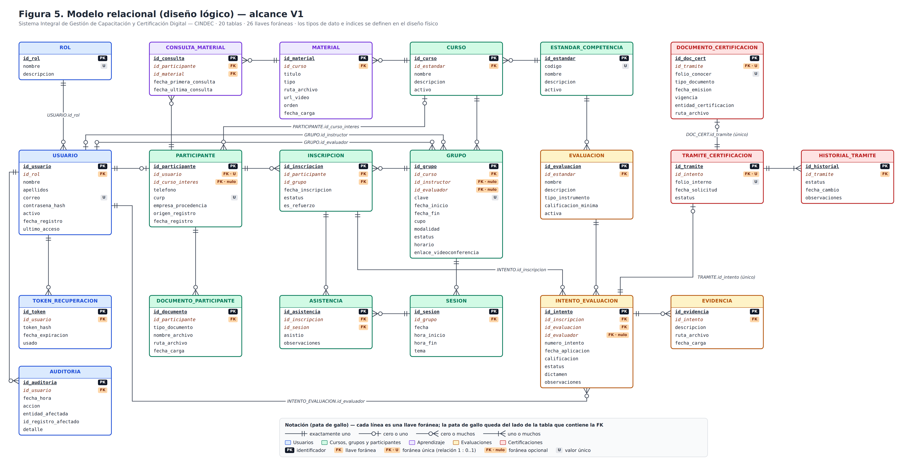

# 03 — Diseño de la base de datos · Parte 1: diseño lógico (modelo relacional)

> Fase: **Diseño del Sistema** · Actividad del cronograma: *Diseño de la base de datos*.
> Base: modelo entidad-relación aprobado (`02-modelo-entidad-relacion.md`, 2026-10-01).
> Estado: **borrador para revisión del residente** (2026-10-01).
> Este paso tiene tres partes: **1. diseño lógico** (este documento), 2. normalización y 3. diseño físico (tipos de dato, índices y diccionario de datos).

## 1. Qué se hizo

Se tradujo cada entidad del modelo E-R a una **tabla** y cada relación a una **llave foránea (FK)**. Reglas de traducción:

| Caso en el E-R | Cómo se traduce |
|---|---|
| Entidad | Tabla con el mismo nombre; su identificador es la **llave primaria (PK)**, entera y autoincremental. |
| Relación 1 : N | La tabla del lado "muchos" recibe una FK hacia la del lado "uno". Ejemplo: GRUPO recibe `id_curso`. |
| Relación 1 : 0..1 | FK con restricción **UNIQUE**, que impide que el lado "uno" se repita. Ejemplo: `TRAMITE_CERTIFICACION.id_intento`. |
| Relación opcional (0..1 del lado padre) | FK que **acepta nulos**. Ejemplo: `GRUPO.id_instructor` mientras el grupo está "planeado". |
| Relación N : M | Ya venían como **entidades asociativas** en el E-R, porque tienen datos propios (INSCRIPCION, ASISTENCIA, CONSULTA_MATERIAL). Aquí se convierten en tablas intermedias con dos FK y una restricción UNIQUE sobre el par, para no duplicar registros. |

Se mantienen las decisiones del ERS:
- **Un rol por usuario** (RF-USR-02): FK `USUARIO.id_rol`.
- **Un estándar por curso** (RF-CUR-01): FK `CURSO.id_estandar`. Un mismo estándar sí puede usarse en varios cursos.

## 2. Diagrama

## 3. Llaves foráneas

20 tablas, **26 llaves foráneas**.

**Política de borrado:** por defecto **RESTRICT**, que no permite borrar un registro mientras otros dependan de él. Usuarios, cursos, estándares y evaluaciones se **desactivan** (`activo = 0`), no se borran. Así se protegen la información de evaluaciones y certificaciones contra borrados accidentales (RNF-08, RNF-10).

| # | Tabla | Llave foránea | Referencia a | ¿Nulo? | ¿Única? | Al borrar el padre | Relación E-R |
|---|---|---|---|---|---|---|---|
| 1 | USUARIO | id_rol | ROL | No | | RESTRICT | ROL *tiene* USUARIO |
| 2 | TOKEN_RECUPERACION | id_usuario | USUARIO | No | | CASCADE ¹ | USUARIO *solicita* TOKEN |
| 3 | AUDITORIA | id_usuario | USUARIO | No | | RESTRICT | USUARIO *genera* AUDITORIA |
| 4 | PARTICIPANTE | id_usuario | USUARIO | No | **Sí** | RESTRICT | USUARIO *es* PARTICIPANTE (1 : 0..1) |
| 5 | PARTICIPANTE | id_curso_interes | CURSO | **Sí** | | SET NULL ² | PARTICIPANTE *se interesa en* CURSO |
| 6 | DOCUMENTO_PARTICIPANTE | id_participante | PARTICIPANTE | No | | RESTRICT | PARTICIPANTE *entrega* DOCUMENTO |
| 7 | CURSO | id_estandar | ESTANDAR_COMPETENCIA | No | | RESTRICT | ESTÁNDAR *se basa en* CURSO |
| 8 | GRUPO | id_curso | CURSO | No | | RESTRICT | CURSO *se oferta en* GRUPO |
| 9 | GRUPO | id_instructor | USUARIO | **Sí** | | RESTRICT | USUARIO *imparte* GRUPO |
| 10 | GRUPO | id_evaluador | USUARIO | **Sí** | | RESTRICT | USUARIO *evalúa* GRUPO |
| 11 | SESION | id_grupo | GRUPO | No | | RESTRICT | GRUPO *programa* SESION |
| 12 | INSCRIPCION | id_participante | PARTICIPANTE | No | (par) ³ | RESTRICT | PARTICIPANTE *se inscribe* |
| 13 | INSCRIPCION | id_grupo | GRUPO | No | (par) ³ | RESTRICT | GRUPO *recibe* |
| 14 | ASISTENCIA | id_inscripcion | INSCRIPCION | No | (par) ³ | RESTRICT | INSCRIPCION *acumula* |
| 15 | ASISTENCIA | id_sesion | SESION | No | (par) ³ | RESTRICT | SESION *registra* |
| 16 | MATERIAL | id_curso | CURSO | No | | RESTRICT | CURSO *contiene* MATERIAL |
| 17 | CONSULTA_MATERIAL | id_participante | PARTICIPANTE | No | (par) ³ | RESTRICT | PARTICIPANTE *realiza* |
| 18 | CONSULTA_MATERIAL | id_material | MATERIAL | No | (par) ³ | RESTRICT | MATERIAL *registra* |
| 19 | EVALUACION | id_estandar | ESTANDAR_COMPETENCIA | No | | RESTRICT | ESTÁNDAR *define* EVALUACION |
| 20 | INTENTO_EVALUACION | id_inscripcion | INSCRIPCION | No | (trío) ⁴ | RESTRICT | INSCRIPCION *presenta* |
| 21 | INTENTO_EVALUACION | id_evaluacion | EVALUACION | No | (trío) ⁴ | RESTRICT | EVALUACION *se aplica en* |
| 22 | INTENTO_EVALUACION | id_evaluador | USUARIO | **Sí** | | RESTRICT | USUARIO *registra resultado* (vacío mientras está "pendiente") |
| 23 | EVIDENCIA | id_intento | INTENTO_EVALUACION | No | | RESTRICT | INTENTO *se respalda con* |
| 24 | TRAMITE_CERTIFICACION | id_intento | INTENTO_EVALUACION | No | **Sí** | RESTRICT | INTENTO *origina* TRAMITE (1 : 0..1) |
| 25 | HISTORIAL_TRAMITE | id_tramite | TRAMITE_CERTIFICACION | No | | RESTRICT | TRAMITE *registra cambios* |
| 26 | DOCUMENTO_CERTIFICACION | id_tramite | TRAMITE_CERTIFICACION | No | **Sí** | RESTRICT | TRAMITE *resguarda* DOCUMENTO (1 : 0..1) |

¹ El token es un dato temporal sin valor histórico.
² Si el curso de interés se eliminara, el participante no se pierde; solo queda sin curso de interés.
³ UNIQUE sobre el par de FK: un participante no se inscribe dos veces al mismo grupo, no tiene dos registros de asistencia en la misma sesión y no tiene dos registros de consulta del mismo material.
⁴ UNIQUE (`id_inscripcion`, `id_evaluacion`, `numero_intento`): no puede haber dos "intento 2" de la misma evaluación en la misma inscripción.

## 4. Reglas que una llave foránea no puede garantizar

Una FK solo asegura que el registro referenciado **exista**. Las siguientes reglas de negocio se validan en la **capa de servicios** del backend (arquitectura, sección 4):

| Regla | Dónde se valida | RF |
|---|---|---|
| `GRUPO.id_instructor` debe ser un usuario con rol Instructor, y `id_evaluador` uno con rol Evaluador | Servicio de cursos | RF-CUR-05 |
| `INTENTO_EVALUACION.id_evaluador` debe ser el evaluador asignado al grupo (o un administrador) | Servicio de evaluaciones | RNF-06 |
| No inscribir si el grupo no tiene cupo, o si su estatus no es "planeado" o "en curso" | Servicio de cursos | RF-CUR-04 |
| La evaluación del intento debe pertenecer al estándar del curso del grupo | Servicio de evaluaciones | RF-EVA-01 |
| Solo se crea un trámite a partir de un intento con dictamen "competente" | Servicio de certificaciones | RF-CERT-01, 02 |
| Al crear un trámite se registra su primer estatus ("solicitado") en el historial | Servicio de certificaciones | RF-CERT-02 |
| `id_usuario` de PARTICIPANTE debe tener rol Participante | Servicio de usuarios | RF-USR-02 |

## 5. Siguientes partes del Paso 3

- **Normalización:** revisar 1FN, 2FN y 3FN tabla por tabla. Queda pendiente decidir si `INTENTO_EVALUACION.estatus` (aprobada / no aprobada) se guarda o se calcula, porque se puede obtener a partir de la calificación y del mínimo.
- **Diseño físico:** tipos de dato MySQL, índices y diccionario de datos.
