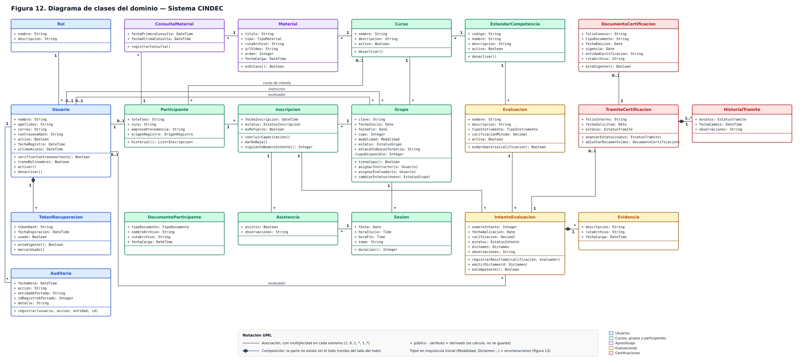
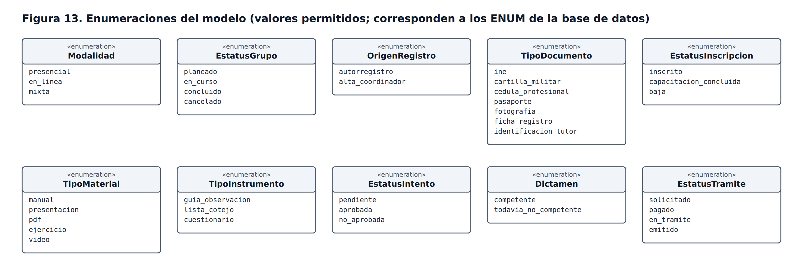

# 04 — Diagramas UML · Parte 2: diagrama de clases

> Fase: **Diseño del Sistema** · Actividad del cronograma: *Diagramas UML*.
> Base: modelo E-R (figura 4), diseño lógico (figura 5), base de datos `cindec_db` (scripts en `sql/`) y casos de uso (figuras 7 a 11).
> Estado: **propuesta aprobada por el residente** (2026-10-21).

## 1. Qué muestra este diagrama

El diagrama de clases describe **los objetos del dominio** del sistema: qué datos guarda cada uno (atributos), qué sabe hacer (operaciones) y cómo se relaciona con los demás (asociaciones con multiplicidad).

Diferencia con el modelo E-R y el diseño lógico:

| Modelo | Responde a… | Ejemplo con GRUPO |
|---|---|---|
| E-R / relacional | ¿Cómo se **guardan** los datos? | Tabla `grupo` con `id_curso`, `id_instructor`, `cupo`… |
| Diagrama de clases | ¿Cómo se **comportan** los objetos en el código? | Clase `Grupo` con `tieneCupo()`, `asignarInstructor(u)`, `cambiarEstatus(nuevo)` |

Por eso en las clases **no aparecen los id ni las llaves foráneas**: se representan con las líneas de asociación. Cada clase corresponderá a un modelo de Sequelize en `backend/src/models/`, y las operaciones las implementará la capa de servicios (ADR-0003).

## 2. Diagramas

Colores por módulo (los mismos del modelo E-R): azul = Usuarios, verde = Cursos, grupos y participantes, morado = Aprendizaje, naranja = Evaluaciones, rojo = Certificaciones.

## 3. Las 20 clases

| Módulo | Clase | Operaciones principales | Caso de uso / RF |
|---|---|---|---|
| Usuarios | Rol | — | RF-USR-02 |
| | Usuario | `verificarContrasena`, `tieneRol`, `activar`, `desactivar` | CU-01, CU-02, CU-04 |
| | TokenRecuperacion | `estaVigente`, `marcarUsado` | CU-03 |
| | Auditoria | `registrar(usuario, accion, entidad, id)` | RNF-10 |
| Cursos, grupos y participantes | EstandarCompetencia, Curso | `desactivar` | CU-05 |
| | Grupo | `tieneCupo`, `asignarInstructor`, `asignarEvaluador`, `cambiarEstatus` | CU-06, CU-08 |
| | Sesion | `duracion` | CU-06 |
| | Participante | `historial()` | CU-07, CU-10 |
| | DocumentoParticipante | — | CU-07 |
| | Inscripcion | `concluirCapacitacion`, `darDeBaja`, `siguienteNumeroIntento` | CU-08 |
| | Asistencia | — | CU-09 |
| Aprendizaje | Material | `esEnlace` | CU-11 |
| | ConsultaMaterial | `registrarConsulta` | CU-12 |
| Evaluaciones | Evaluacion | `esAprobatoria(calificacion)` | CU-13 |
| | IntentoEvaluacion | `registrarResultado`, `emitirDictamen`, `esCompetente` | CU-14, CU-15 |
| | Evidencia | — | CU-14 |
| Certificaciones | TramiteCertificacion | `avanzarEstatus`, `adjuntarDocumento` | CU-17, CU-18 |
| | HistorialTramite | — | CU-18 |
| | DocumentoCertificacion | `estaVigente` | CU-19, CU-21 |

## 4. Relaciones

- **Asociaciones:** son las mismas 26 relaciones del diseño lógico, con su multiplicidad (`1`, `0..1`, `*`, `1..*`). Usuario se relaciona con Grupo dos veces, con los papeles **instructor** y **evaluador**, y con IntentoEvaluacion como **evaluador** del resultado.
- **Composiciones (◆):** la parte no tiene sentido sin el todo y se crea y se elimina con él.
  - Usuario ◆ TokenRecuperacion: coincide con el `ON DELETE CASCADE` de la base de datos.
  - TramiteCertificacion ◆ HistorialTramite: cada cambio de estatus pertenece a un solo trámite (`1..*` porque siempre existe al menos "solicitado").
  - IntentoEvaluacion ◆ Evidencia: la evidencia respalda un intento concreto.
  - En la base de datos estas dos últimas usan RESTRICT, porque los resultados y trámites no se borran (RNF-06, RNF-08); la composición describe la **pertenencia**, no un borrado automático.
- **Atributo derivado `/cupoDisponible`** en Grupo: se calcula (`cupo − inscripciones activas`) y no se guarda, como se decidió en la normalización.

## 5. Enumeraciones

Las 10 enumeraciones de la figura 13 son exactamente los valores de los `ENUM` de los scripts SQL. Se escriben con guion bajo (`todavia_no_competente`) igual que en la base de datos; la interfaz muestra el texto con formato ("Todavía no competente").

## 6. Siguiente parte

**Diagramas de secuencia (4.3):** inscripción con control de cupo y trámite de certificación, recorriendo las capas Frontend → Rutas/Middlewares → Controlador → Servicio → Modelos → MySQL.
