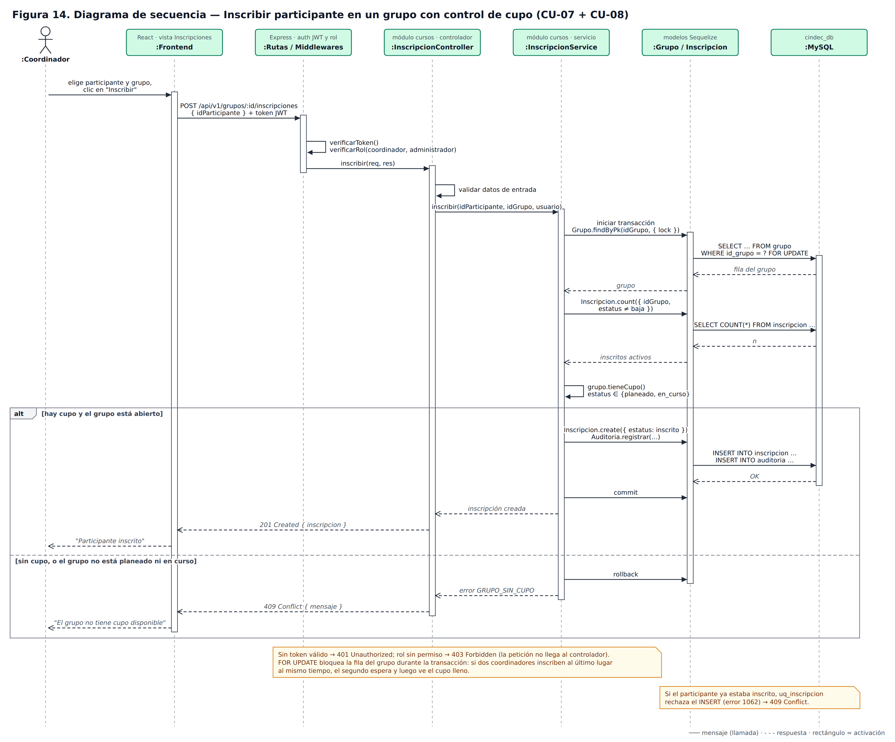
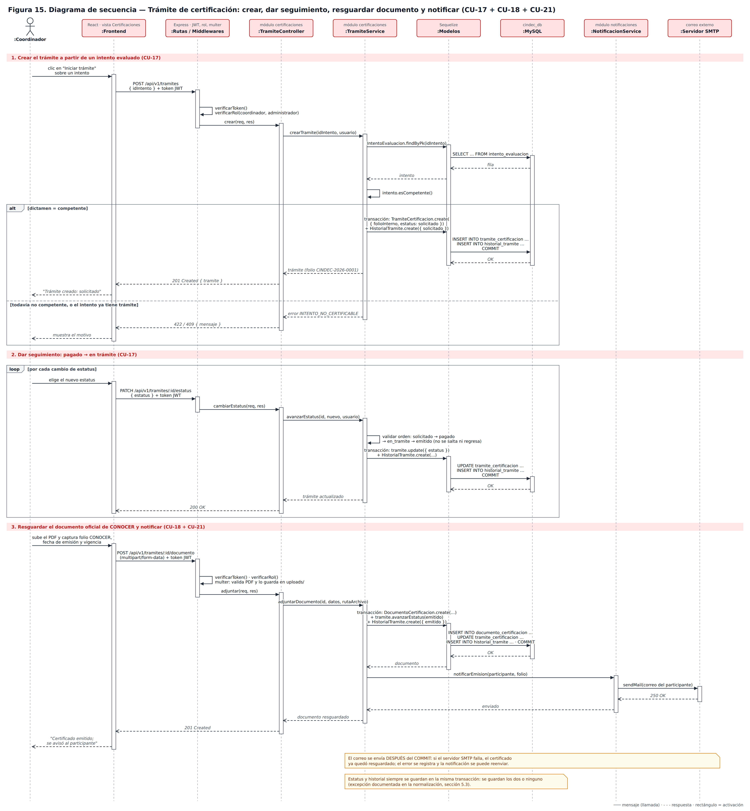

# 04 — Diagramas UML · Parte 3: diagramas de secuencia

> Fase: **Diseño del Sistema** · Actividad del cronograma: *Diagramas UML*.
> Base: arquitectura (ADR-0003, figura 2), diagrama de clases (figura 12), base de datos `cindec_db` y casos de uso (figuras 7 a 11).
> Estado: **borrador para revisión del residente** (2026-10-21).

## 1. Qué muestra un diagrama de secuencia

El diagrama de clases muestra **qué objetos existen**. El de secuencia muestra **en qué orden se comunican** para resolver un caso de uso: quién llama a quién, qué responde y qué pasa cuando algo sale mal.

Cómo se lee:

| Elemento | Significado |
|---|---|
| Recuadro arriba + línea punteada vertical | Un participante (capa o componente) y su línea de vida; el tiempo avanza hacia abajo. |
| Flecha sólida | Mensaje o llamada (petición HTTP, llamada a función, consulta SQL). |
| Flecha punteada | Respuesta. |
| Rectángulo delgado sobre la línea de vida | Activación: el componente está trabajando. |
| Marco `alt` | Caminos alternativos, como un `if / else`; se ejecuta solo uno. |
| Marco `loop` | Se repite mientras se cumpla la condición. |
| Nota amarilla | Aclaración de diseño. |

Los participantes siguen las capas de la arquitectura: **Frontend (React) → Rutas / Middlewares → Controlador → Servicio → Modelos (Sequelize) → MySQL**. Así se comprueba que cada capa hace solo su parte: los middlewares autentican, el controlador recibe y responde, el servicio aplica las reglas de negocio y los modelos hablan con la base de datos.

Se eligieron los dos procesos con más reglas de negocio. Los demás casos de uso siguen el mismo recorrido de capas.

## 2. Figura 14 — Inscribir participante con control de cupo (CU-07 + CU-08)

Puntos de diseño:

- **Seguridad primero:** sin token válido la API responde `401` y con un rol sin permiso responde `403`; la petición no llega al controlador (RNF de seguridad, RF-USR-02).
- **Control de cupo en el servicio** (RF-CUR-04): `grupo.tieneCupo()` compara el cupo con las inscripciones activas (`/cupoDisponible` del diagrama de clases) y revisa que el grupo esté *planeado* o *en curso*.
- **Último lugar disputado:** la consulta del grupo usa `SELECT … FOR UPDATE` dentro de una transacción. Si dos coordinadores inscriben al mismo tiempo en el último lugar, el segundo espera y después ve el cupo lleno.
- **Duplicados:** si el participante ya estaba en el grupo, la restricción `uq_inscripcion` rechaza el INSERT (error 1062, comprobado en las pruebas de la base de datos) y la API responde `409 Conflict`.
- **Auditoría** (RNF-10): la inscripción y su registro en `auditoria` se guardan en la misma transacción.

## 3. Figura 15 — Trámite de certificación (CU-17 + CU-18 + CU-21)

El diagrama tiene tres partes:

1. **Crear el trámite (CU-17):** el servicio carga el intento y usa `intento.esCompetente()`. Solo con dictamen *competente* crea el trámite con estatus *solicitado* y su primer registro en el historial (RF-CERT-01, 02). Si el intento no es competente o ya tiene trámite, responde `422` / `409`.
2. **Seguimiento (CU-17):** en un `loop`, cada cambio de estatus valida el orden `solicitado → pagado → en_tramite → emitido` (no se salta ni se regresa) y guarda el estatus y el historial en la misma transacción. Es la forma de mantener consistente la excepción documentada en la normalización (sección 5.3).
3. **Resguardar y notificar (CU-18 + CU-21):** el middleware `multer` valida que el archivo sea PDF y lo guarda en `uploads/`; el servicio registra el documento, pasa el trámite a *emitido* y guarda el historial. Después del `COMMIT`, el módulo de notificaciones envía el correo al participante por SMTP.

**Decisión: el correo va fuera de la transacción.** Si el servidor SMTP falla, el certificado ya quedó resguardado; el error se registra y la notificación se puede reenviar. Así una falla externa no deshace un trámite válido.

## 4. Códigos de respuesta usados

| Código | Cuándo |
|---|---|
| 200 OK | Cambio de estatus correcto. |
| 201 Created | Se creó la inscripción, el trámite o el documento. |
| 401 Unauthorized | No hay token o expiró. |
| 403 Forbidden | El rol no tiene permiso. |
| 409 Conflict | Grupo sin cupo, inscripción duplicada o intento que ya tiene trámite. |
| 422 Unprocessable Entity | El intento no tiene dictamen *competente*. |

## 5. Cierre del Paso 4

Con casos de uso (figuras 7 a 11), clases (figuras 12 y 13) y secuencia (figuras 14 y 15) queda completo el Paso 4. **Siguiente: Paso 5, prototipos de pantallas.**
