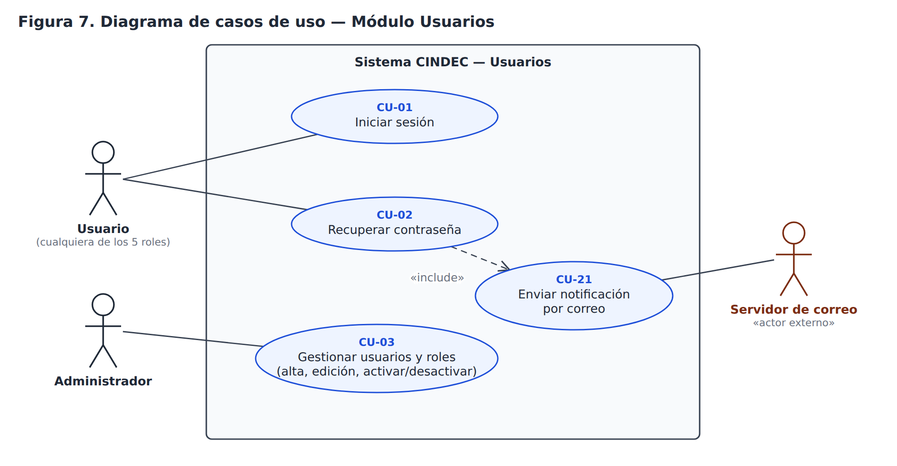
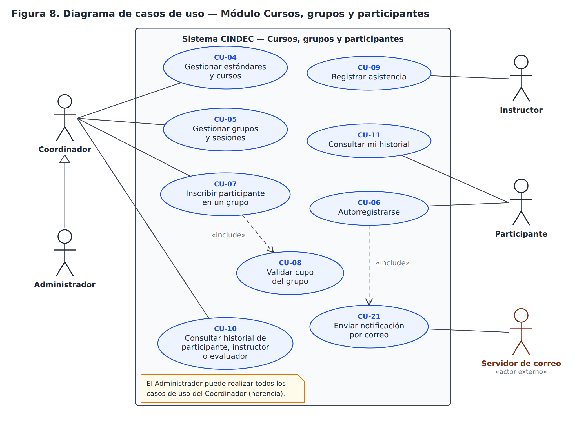
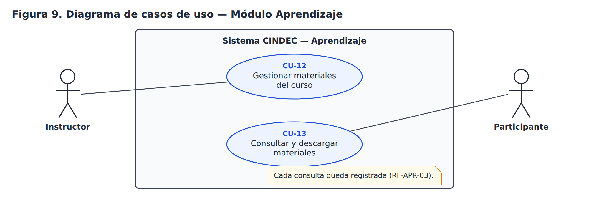
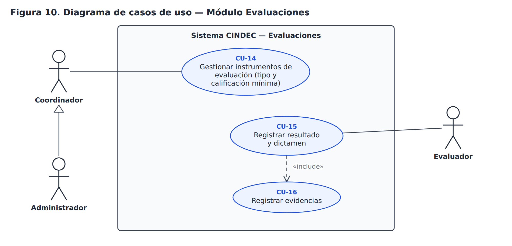
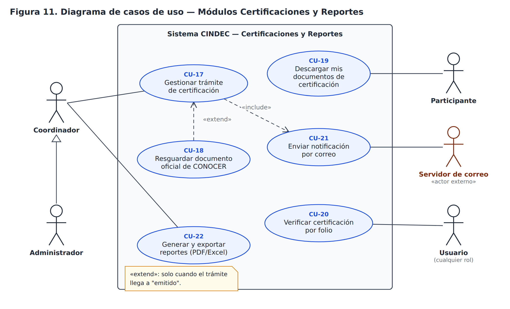

# 04 — Diagramas UML · Parte 1: casos de uso

> Fase: **Diseño del Sistema** · Actividad del cronograma: *Elaboración de diagramas UML*.
> Base: ERS v1.1 (RF, tabla de permisos por rol y casos de uso de nivel alto, sección 3.4).
> Estado: **aprobado por el residente** (2026-10-21).

## 1. Propósito

Los diagramas de casos de uso muestran **quién** usa el sistema (actores) y **para qué** (casos de uso). Hay uno por módulo para que cada diagrama sea legible; la tabla de la sección 3 es la matriz completa.

## 2. Notación

| Elemento | Significado |
|---|---|
| Muñequito | **Actor**: un rol del ERS o un sistema externo. El servidor de correo es un actor externo. |
| Óvalo | **Caso de uso**: algo que el actor logra con el sistema (verbo + objeto). |
| Rectángulo | **Límite del sistema**: lo que está dentro lo hace el sistema CINDEC. |
| Línea continua | El actor participa en el caso de uso. |
| Flecha punteada «include» | El caso de uso **siempre** usa al otro. |
| Flecha punteada «extend» | El caso de uso **agrega pasos a otro solo bajo una condición**. |
| Flecha con triángulo hueco | **Herencia entre actores**: el Administrador puede hacer todo lo del Coordinador. |

Decisiones: el Administrador hereda del Coordinador; "Gestionar" agrupa crear, consultar, editar y desactivar; CONOCER **no** es actor porque el sistema no se conecta con él (ERS 2.4); el Coordinador gestiona los instrumentos de evaluación (CU-14).

## 3. Catálogo de casos de uso (22)

| CU | Caso de uso | Actor(es) | Relaciones | RF |
|---|---|---|---|---|
| CU-01 | Iniciar sesión | Todos los roles | | RF-USR-05 |
| CU-02 | Recuperar contraseña | Todos los roles | «include» CU-21 | RF-USR-06 |
| CU-03 | Gestionar usuarios y roles (alta, edición, activar/desactivar) | Administrador | | RF-USR-01 a 04 |
| CU-04 | Gestionar estándares y cursos | Coordinador | | RF-CUR-01 |
| CU-05 | Gestionar grupos y sesiones | Coordinador | | RF-CUR-02, 05, 08, 09 |
| CU-06 | Autorregistrarse (datos, CURP, documentos) | Participante (sin sesión) | «include» CU-21 | RF-CUR-03 |
| CU-07 | Inscribir participante en un grupo | Coordinador | «include» CU-08 | RF-CUR-04 |
| CU-08 | Validar cupo del grupo | (interno) | | RF-CUR-04 |
| CU-09 | Registrar asistencia | Instructor | | RF-CUR-10 |
| CU-10 | Consultar historial de participante, instructor o evaluador | Coordinador | | RF-CUR-06, 07 |
| CU-11 | Consultar mi historial (cursos, evaluaciones, certificaciones) | Participante | | RF-CUR-06, RF-EVA-05 |
| CU-12 | Gestionar materiales del curso | Instructor | | RF-APR-01 |
| CU-13 | Consultar y descargar materiales | Participante | | RF-APR-02, 03 |
| CU-14 | Gestionar instrumentos de evaluación (tipo y calificación mínima) | Coordinador | | RF-EVA-01, 04 |
| CU-15 | Registrar resultado y dictamen de evaluación | Evaluador | «include» CU-16 | RF-EVA-02, 03, 04 |
| CU-16 | Registrar evidencias | Evaluador | | RF-EVA-02 |
| CU-17 | Gestionar trámite de certificación | Coordinador | «include» CU-21 (al emitirse) | RF-CERT-01, 02, 05 |
| CU-18 | Resguardar documento oficial de CONOCER | Coordinador | «extend» CU-17 (al emitirse) | RF-CERT-03, 04 |
| CU-19 | Descargar mis documentos de certificación | Participante | | RF-CERT-06 |
| CU-20 | Verificar certificación por folio | Todos los roles (con sesión) | | RF-CERT-07 |
| CU-21 | Enviar notificación por correo | Servidor de correo (externo) | | RF-NOT-01 |
| CU-22 | Generar y exportar reportes (PDF/Excel) | Coordinador | | RF-REP-01, 02 |

Todos los RF del ERS quedan cubiertos por al menos un caso de uso.

## 4. Diagramas

## 5. Siguientes partes del Paso 4

- **Diagrama de clases** del dominio.
- **Diagramas de secuencia**: inscripción con control de cupo (CU-07 + CU-08) y trámite de certificación (CU-17 + CU-18 + CU-21).
