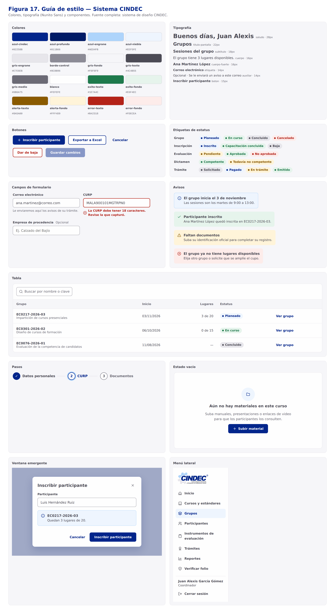

# 05 — Prototipos · Parte 3: guía de estilo

> Fase: **Diseño del Sistema** · Actividad del cronograma: *Prototipos de interfaz*.
> Base: identidad de CINDEC (logo y colores entregados por el residente), RNF-02 y RNF-11.
> Estado: **borrador para revisión del residente** (2026-10-21). Decisiones aprobadas: paleta con tonos de apoyo, voz de usted, "Todavía no competente" en ámbar.
> Versión navegable y completa: **Sistema de diseño CINDEC** (artifact en Claude), con cada componente en vivo.

## 1. Para qué sirve

La guía de estilo define **una sola vez** cómo se ven y cómo se escriben todas las pantallas: colores, tipografía, espacios y componentes. Así el sistema es consistente (RNF-11), los prototipos se arman con piezas ya definidas y, en Desarrollo, cada componente se programa una vez en React y se reutiliza.

> La figura se generó con una fuente de respaldo porque el entorno de dibujo no tenía instalada Nunito Sans; la tipografía real se ve en el sistema de diseño y en los prototipos.

## 2. Identidad

| Elemento | Decisión |
|---|---|
| Logo | `Logo-CINDEC-transparente.png`, siempre sobre fondo blanco o gris claro. Va en el menú lateral, el inicio de sesión y los documentos. |
| Nombre | "Centro Integral de Desarrollo y Evaluación de Competencia Laboral" (texto del logo). |
| Red CONOCER | Su logo solo aparece en certificaciones y en Verificar folio, más pequeño que el de CINDEC. Su color no se usa en la interfaz. |

## 3. Colores

| Token | Valor | Origen | Uso |
|---|---|---|---|
| azul-cindec | `#02258B` | Letras del logo | Único color fuerte: botón principal, opción activa, títulos de marca |
| azul-profundo | `#011B66` | Apoyo | Botón principal al pasar el mouse |
| azul-engrane | `#AED4FB` | Engrane del logo | Detalles pequeños (paso actual, borde de aviso informativo) |
| azul-niebla | `#EEF5FE` | Apoyo | Opción activa del menú, fila seleccionada, avisos informativos |
| gris-engrane | `#E7E6EB` | Engrane del logo | Bordes de tarjetas y separadores |
| borde-control | `#8C8B96` | Apoyo | Borde de campos (3.4:1, mínimo para controles) |
| gris-fondo | `#F6F6F9` | Apoyo | Fondo de página |
| gris-texto | `#4C4B55` | Texto del logo | Texto principal |
| gris-medio | `#6B6A75` | Apoyo | Texto secundario |
| blanco | `#FEFEFE` | Fondo del logo | Tarjetas, menú, ventanas |
| exito / alerta / error | verde, ámbar, rojo (texto + fondo suave) | Apoyo | Estatus y avisos |

Todas las combinaciones de texto cumplen al menos **4.5:1** (WCAG AA). El foco del teclado es un contorno azul-cindec de 3 px.

## 4. Tipografía

**Nunito Sans**, una sola familia (Google Fonts; en React se instala con `@fontsource/nunito-sans` para funcionar sin internet).

| Estilo | Tamaño / grosor | Uso |
|---|---|---|
| saludo | 28 px / 800 | Solo el panel de inicio |
| titulo-pantalla | 22 px / 700 | Uno por pantalla |
| subtitulo | 18 px / 600 | Secciones y tarjetas |
| cuerpo | 16 px / 400 | Texto general |
| cuerpo-fuerte | 16 px / 700 | Dato principal de una fila |
| etiqueta | 14 px / 700 | Etiquetas de campos y encabezados de tabla |
| auxiliar | 14 px / 400 | Ayudas y fechas |
| boton | 15 px / 700 | Botones |

## 5. Espacios, formas y estructura

- Espacios: 4 · 8 · 16 · 24 · 32 · 48 px.
- Esquinas: 8 px (botones, campos, avisos), 12 px (tarjetas, ventanas), píldora (estatus).
- Sombra: solo la ventana emergente.
- Pantalla: menú lateral de 264 px + contenido de máximo 1120 px. En celular (menos de 900 px) el menú se oculta tras un botón y las tablas se vuelven tarjetas.

## 6. Componentes

| Componente | Regla principal |
|---|---|
| Botón | Uno principal por pantalla; el texto dice la acción exacta ("Inscribir participante"). |
| Campo de texto | Etiqueta visible arriba; error debajo con instrucción para corregir. |
| Etiqueta de estatus | Color + texto; un color por cada valor de los ENUM (tabla abajo). |
| Aviso | Título de lo que pasó + frase de qué hacer; sin códigos técnicos. |
| Tabla | Máximo 6 columnas, buscador arriba, acción al final de la fila. |
| Menú lateral | Logo, opciones del rol con ícono y texto, usuario y Cerrar sesión. |
| Pasos | Para el autorregistro: Datos personales → CURP → Documentos. |
| Ventana emergente | Solo para acciones cortas o confirmaciones. |
| Estado vacío | Dice qué falta y cómo empezar. |

### Colores de estatus (valores de la base de datos)

| Entidad | Valores | Color |
|---|---|---|
| Grupo | planeado · en_curso · concluido · cancelado | azul · verde · gris · rojo |
| Inscripción | inscrito · capacitacion_concluida · baja | azul · verde · gris |
| Intento | pendiente · aprobada · no_aprobada | ámbar · verde · rojo |
| Dictamen | competente · todavia_no_competente | verde · **ámbar** |
| Trámite | solicitado · pagado · en_tramite · emitido | gris · azul · ámbar · verde |

"Todavía no competente" va en ámbar porque no es un rechazo definitivo: la persona puede volver a evaluarse.

## 7. Voz y textos

- El sistema habla **de usted**: "Escriba su correo electrónico".
- Botones con verbo + objeto; la confirmación repite el verbo ("Inscribir participante" → "Participante inscrito").
- Errores en lenguaje claro: "El grupo ya no tiene lugares disponibles. Elija otro grupo o solicite que se amplíe el cupo."
- Los valores de la base de datos se muestran en español natural (`en_tramite` → "En trámite").
- Fechas dd/mm/aaaa; horas en formato de 24 h.

## 8. Íconos

Librería **Lucide** (`lucide-react`): línea fina, siempre acompañando a una palabra. Sin emojis.
