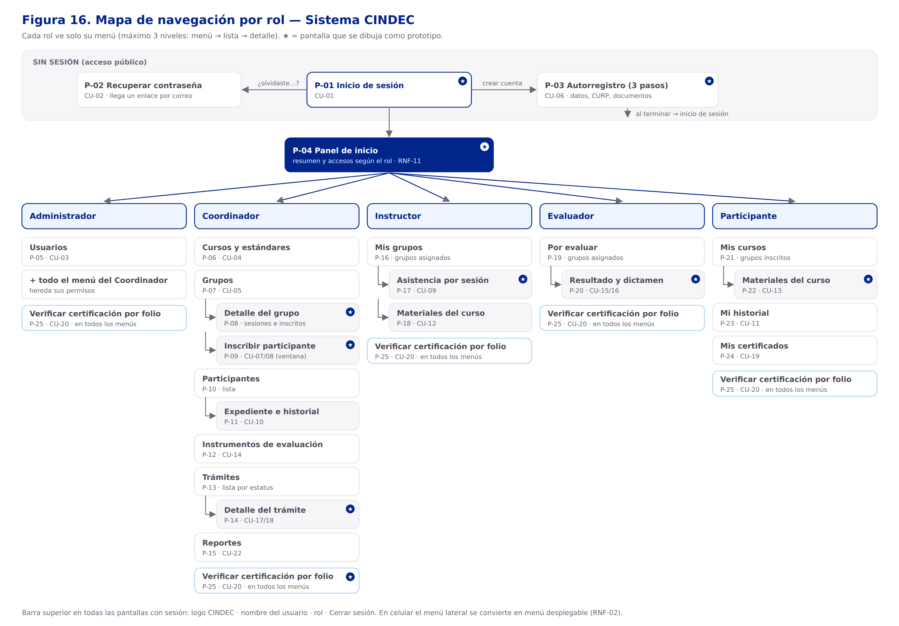
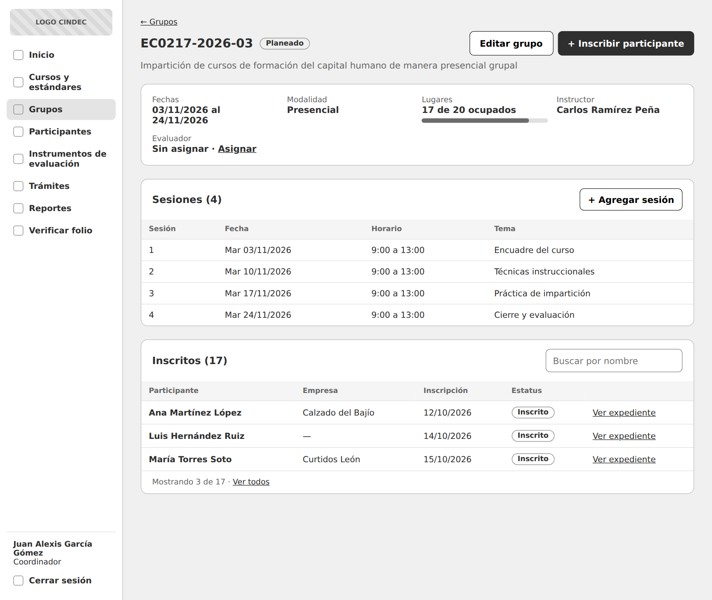
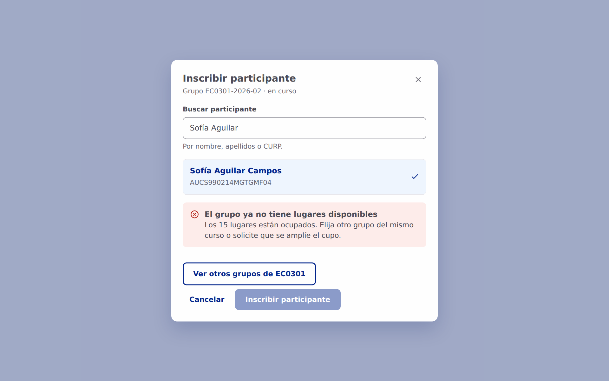
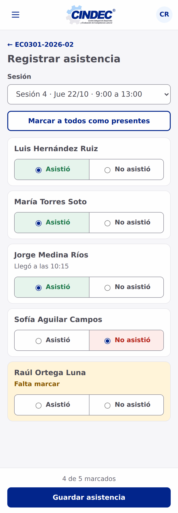

# 05 — Prototipos de pantallas

> Fase: **Diseño del Sistema** · Actividad del cronograma: *Prototipos de interfaz*.
> Base: casos de uso (figuras 7 a 11), RNF-02 (adaptable a móvil) y RNF-11 (navegación clara y consistente).
> Estado: **aprobado** (2026-10-21). El asesor empresarial delegó en el residente la elección del diseño (ver 5.7).

## Contenido del paso

| Parte | Tema | Estado |
|---|---|---|
| 5.1 | Inventario de pantallas | Aprobado |
| 5.2 | Mapa de navegación por rol (figura 16) | Aprobado |
| 5.3 | Guía de estilo (figura 17, [`05-2-guia-de-estilo.md`](05-2-guia-de-estilo.md)) | Aprobado |
| 5.4 | Wireframes (10 pantallas) | Aprobado |
| 5.5 | Mockups (11 pantallas) | Aprobado |
| 5.6 | Pantallas en el navegador del celular (4) | Aprobado |
| 5.7 | Validación con el asesor empresarial | Delegada al residente (2026-10-21) |

## Principios de diseño

Pedido del residente: una interfaz **amigable, fácil de entender y no saturada**. Se traduce en estas reglas:

1. **Una tarea por pantalla.**
2. **Un solo botón principal** por pantalla, en azul CINDEC; las demás acciones son discretas.
3. **Menú según el rol:** cada usuario ve solo lo que puede hacer.
4. **Máximo 3 niveles:** menú → lista → detalle.
5. **Formularios largos por pasos** (autorregistro en 3 pasos).
6. **Tablas cortas:** solo columnas esenciales, con buscador y filtro; el resto se ve en el detalle.
7. **Estatus con color y con texto** (nunca solo con color).
8. **Mensajes en lenguaje claro** ("El grupo ya no tiene lugares disponibles", no "Error 409").
9. **Letra legible** (15–16 px) y contraste mínimo 4.5:1 (WCAG AA).

## 5.1 Inventario de pantallas

25 pantallas cubren los 22 casos de uso. Las marcadas con ★ (10) se dibujan como prototipo; las demás siguen el mismo patrón de *lista + formulario* y se construyen igual en Desarrollo.

### Sin sesión

| ID | Pantalla | Qué hace el usuario | CU | ★ |
|---|---|---|---|---|
| P-01 | Inicio de sesión | Escribe correo y contraseña | CU-01 | ★ |
| P-02 | Recuperar contraseña | Pide un enlace por correo y define una contraseña nueva | CU-02 | |
| P-03 | Autorregistro (3 pasos) | Captura sus datos, CURP y sube sus documentos | CU-06 | ★ |

### Todos los roles con sesión

| ID | Pantalla | Qué hace el usuario | CU | ★ |
|---|---|---|---|---|
| P-04 | Panel de inicio | Ve un resumen y accesos según su rol | RNF-11 | ★ |
| P-25 | Verificar certificación por folio | Escribe un folio y ve si el documento es válido | CU-20 | ★ |

### Administrador (además de todo lo del Coordinador)

| ID | Pantalla | Qué hace el usuario | CU | ★ |
|---|---|---|---|---|
| P-05 | Usuarios | Da de alta, edita, asigna rol y activa o desactiva | CU-03 | |

### Coordinador

| ID | Pantalla | Qué hace el usuario | CU | ★ |
|---|---|---|---|---|
| P-06 | Cursos y estándares | Gestiona estándares de competencia y cursos | CU-04 | |
| P-07 | Grupos | Lista de grupos con cupo y estatus; crea grupos | CU-05 | |
| P-08 | Detalle del grupo | Ve datos, sesiones e inscritos; asigna instructor y evaluador | CU-05 | ★ |
| P-09 | Inscribir participante (ventana) | Busca al participante y lo inscribe; ve el aviso si no hay cupo | CU-07, CU-08 | ★ |
| P-10 | Participantes | Busca participantes | CU-10 | |
| P-11 | Expediente e historial | Ve datos, documentos e historial de cursos, evaluaciones y certificaciones | CU-10 | |
| P-12 | Instrumentos de evaluación | Define tipo de instrumento y calificación mínima | CU-14 | |
| P-13 | Trámites | Lista de trámites filtrada por estatus | CU-17 | |
| P-14 | Detalle del trámite | Avanza el estatus, ve el historial y sube el PDF de CONOCER | CU-17, CU-18 | ★ |
| P-15 | Reportes | Elige reporte y periodo; exporta a PDF o Excel | CU-22 | |

### Instructor

| ID | Pantalla | Qué hace el usuario | CU | ★ |
|---|---|---|---|---|
| P-16 | Mis grupos | Ve los grupos que tiene asignados | CU-09 | |
| P-17 | Asistencia por sesión | Marca quién asistió a cada sesión | CU-09 | ★ |
| P-18 | Materiales del curso | Sube manuales, presentaciones, PDF o enlaces de video | CU-12 | |

### Evaluador

| ID | Pantalla | Qué hace el usuario | CU | ★ |
|---|---|---|---|---|
| P-19 | Por evaluar | Ve los grupos y participantes que le toca evaluar | CU-15 | |
| P-20 | Resultado y dictamen | Registra calificación, dictamen y evidencias | CU-15, CU-16 | ★ |

### Participante

| ID | Pantalla | Qué hace el usuario | CU | ★ |
|---|---|---|---|---|
| P-21 | Mis cursos | Ve los grupos en los que está inscrito | CU-13 | |
| P-22 | Materiales del curso | Consulta y descarga materiales | CU-13 | ★ |
| P-23 | Mi historial | Ve sus cursos, evaluaciones y certificaciones | CU-11 | |
| P-24 | Mis certificados | Descarga sus documentos de certificación | CU-19 | |

**Criterio para elegir las 10 ★:** cubren los cinco roles, los dos procesos de los diagramas de secuencia (figuras 14 y 15) y los distintos tipos de pantalla (acceso, formulario por pasos, tablero, detalle, ventana emergente, captura rápida y consulta).

## 5.2 Mapa de navegación

Cómo funciona:
- **Sin sesión** solo existen tres pantallas: iniciar sesión, recuperar contraseña y autorregistro. Al terminar el autorregistro, el participante regresa al inicio de sesión.
- Al iniciar sesión, todos llegan al **panel de inicio**, que muestra un resumen distinto según el rol (por ejemplo, el coordinador ve grupos en curso y trámites pendientes; el participante ve sus cursos).
- **Menú lateral por rol.** El más largo es el del Coordinador (7 opciones); el del Evaluador tiene 2. El Administrador ve lo mismo que el Coordinador más *Usuarios*, igual que en la herencia de actores de los casos de uso.
- **Verificar certificación por folio** aparece en todos los menús (CU-20 es para todos los roles con sesión).
- **Barra superior** en todas las pantallas con sesión: logo de CINDEC, nombre del usuario, rol y *Cerrar sesión*.
- **En celular** el menú lateral se oculta y se abre con un botón (RNF-02).

## 5.3 Guía de estilo

Documentada en [`05-2-guia-de-estilo.md`](05-2-guia-de-estilo.md) (figura 17) y en el **Sistema de diseño CINDEC** (artifact navegable con cada componente en vivo). Decisiones: colores del logo de CINDEC como base, tipografía Nunito Sans, voz de **usted** y "Todavía no competente" en ámbar.

## Herramienta y archivos

Los prototipos se dibujaron en el lienzo **Prototipos Sistema CINDEC** (Claude Design), con tres páginas: *5.4 Wireframes*, *5.5 Mockups* y *5.6 Celular (navegador)*. Varias pantallas están enlazadas entre sí para recorrerlas como prototipo navegable (inicio de sesión → panel → grupo → inscribir).

Copias en imagen dentro del repositorio:

| Carpeta | Contenido |
|---|---|
| `img/prototipos/wireframes/` | P01, P03, P04, P08, P09, P14, P17, P20, P22, P25 |
| `img/prototipos/mockups/` | M01, M03, M04, M08, M09, **M09b (sin cupo)**, M14, M17, M20, M22, M25 |
| `img/prototipos/celular/` | C00 (menú abierto), C17, C22, C25 |

> Las imágenes se generaron con una fuente de respaldo; la tipografía exacta (Nunito Sans) se ve en el lienzo.

## 5.4 Wireframes

Versión en gris de las 10 pantallas ★ para acordar **qué contiene cada pantalla y en qué orden**, sin distraer con colores. Decisiones tomadas en esta parte:

- **Autorregistro en tres pasos:** 1 Cuenta (nombre, apellidos, correo, contraseña) · 2 Datos personales (CURP, teléfono, empresa de procedencia, curso de interés) · 3 Documentos.
- **Panel del coordinador:** tres accesos rápidos (grupos en curso, lugares libres, trámites por avanzar), próximas sesiones y trámites que requieren atención.
- **Inscribir participante** se abre como ventana sobre el detalle del grupo; el buscador avisa si la persona ya está inscrita (`uq_inscripcion`).
- **Detalle del trámite:** barra de avance de los cuatro estatus, carga del PDF de CONOCER e historial con fecha y responsable.

## 5.5 Mockups

Las mismas pantallas con la guía de estilo aplicada, más la variante **sin cupo** de la ventana de inscribir.

| Pantalla | Archivo | Caso de uso |
|---|---|---|
| Inicio de sesión | `M01-inicio-sesion.png` | CU-01 |
| Autorregistro, paso 2 | `M03-autorregistro.png` | CU-06 |
| Panel de inicio (Coordinador) | `M04-panel.png` | RNF-11 |
| Detalle del grupo | `M08-detalle-grupo.png` | CU-05 |
| Inscribir participante, con cupo | `M09-inscribir.png` | CU-07 |
| Inscribir participante, **sin cupo** | `M09b-sin-cupo.png` | CU-08 (figura 14) |
| Detalle del trámite | `M14-detalle-tramite.png` | CU-17, CU-18 (figura 15) |
| Asistencia (Instructor) | `M17-asistencia.png` | CU-09 |
| Resultado y dictamen (Evaluador) | `M20-resultado-dictamen.png` | CU-15, CU-16 |
| Materiales (Participante) | `M22-materiales.png` | CU-13 |
| Verificar folio | `M25-verificar-folio.png` | CU-20 |

Cómo se aplicaron los principios:
- El azul CINDEC solo marca el botón principal, la opción activa y los datos clave; el resto es blanco y gris claro.
- Cada estatus usa su etiqueta de color con texto (Planeado, En trámite, Competente, Baja).
- Ayudas en el momento: "Aprobada: es igual o mayor que 80" al capturar la calificación, "Falta marcar" en asistencia, "Sin asignar" en ámbar para el evaluador del grupo.
- En el caso sin cupo, el botón de inscribir se deshabilita y se ofrece una salida ("Ver otros grupos de EC0301").

## 5.6 El sistema en el navegador del celular (RNF-02)

No es una aplicación aparte: son las **mismas pantallas** abiertas en el navegador del teléfono, acomodadas al ancho de 390 px con diseño adaptable (RNF-01 y RNF-02).

| En computadora | En el celular |
|---|---|
| Menú lateral siempre visible | Botón ☰ en la barra superior; el menú se desliza sobre la pantalla (`C00-menu-celular.png`) |
| Tablas con columnas | Tarjetas apiladas (`C17-asistencia-celular.png`) |
| Campos en dos columnas | Un campo debajo de otro, a todo lo ancho (`C25-verificar-folio-celular.png`) |
| Botones a la derecha | Botones a todo lo ancho y el principal fijo abajo |

## 5.7 Validación con el asesor empresarial

El 21 de octubre de 2026, Juan Alexis García Gómez (asesor empresarial) indicó que no podía revisar los prototipos en ese momento y **dio libertad al residente para elegir el diseño**. Con base en esa indicación, el residente aprobó los prototipos y la fase de Diseño continúa.

Cuando el asesor tenga oportunidad, se le presentarán los mockups (lienzo compartido o imágenes de `img/prototipos/`) con estas preguntas; cualquier ajuste se aplicará durante Desarrollo:

1. ¿El menú de cada rol tiene lo que esa persona necesita? ¿Sobra o falta alguna opción?
2. Panel del coordinador: ¿los tres accesos rápidos son los que más consulta?
3. Autorregistro: ¿los datos y el orden de los pasos coinciden con la ficha de registro que usa CINDEC?
4. Inscripción: ¿el aviso de cupo y la variante sin cupo reflejan cómo trabajan hoy?
5. Trámite: ¿los cuatro estatus y los datos del documento de CONOCER (folio, fecha de emisión, vigencia) son correctos?
6. Dictamen: ¿la calificación mínima y las dos opciones de dictamen se ven claras para el evaluador?
7. Identidad: ¿el logo, los colores y el texto "Centro Integral de Desarrollo y Evaluación de Competencia Laboral" son los que quieren mostrar?
8. ¿Usarían el sistema desde el celular? ¿Qué rol lo haría más?
